# Banco de dados — ClinicalStudyPB

O banco é um **PostgreSQL 17** executado em Docker. A estrutura é criada por **migrations em SQL puro**
(pasta `backend/migrations/`), aplicadas pelo script `db:migrate`. O projeto não usa ORM: o backend
acessa o banco com o driver `pg`.

## 1. Como conectar

O serviço `postgres` do `docker-compose.yml` publica a porta apenas na própria máquina.

| Campo | Valor |
|---|---|
| Host | `localhost` |
| Porta | `5433` (a `5432` é só a porta interna do container) |
| Banco | `clinicalstudypb` |
| Usuário | `clinicalstudy` |
| Senha | `clinicalstudy_local` (somente desenvolvimento local) |

URL JDBC: `jdbc:postgresql://localhost:5433/clinicalstudypb`

Dentro da rede do Compose, o backend usa `postgres:5432` (variável `DATABASE_URL`).

## 2. Diagrama entidade-relacionamento

O diagrama usa a notação de Chen: **retângulos azuis** são entidades, **losangos rosa** são
relacionamentos e **elipses cinza** são atributos. As cardinalidades (`1`, `N`, `0..1`) estão nas
linhas que ligam as entidades aos losangos.

As colunas de chave estrangeira (`id_estudo`, `id_usuario` etc.) não aparecem como atributos, porque
os losangos já representam esses vínculos; a tabela da seção 2.1 mostra qual coluna implementa cada
relacionamento. `PK` indica chave primária e `UK` indica valor único.

```mermaid
flowchart TB
    %% ENTIDADES
    U["USUÁRIO"]
    SS["SESSÃO"]
    E["ESTUDO"]
    CE["CRITÉRIO DE ELEGIBILIDADE"]
    VP["VISITA PREVISTA"]
    AV["ATIVIDADE DE VISITA"]
    C["CANDIDATO"]
    AE["AVALIAÇÃO DE ELEGIBILIDADE"]
    CO["CONSENTIMENTO"]
    P["PARTICIPAÇÃO NO ESTUDO"]
    V["VISITA"]
    RA["RESULTADO DE AVALIAÇÃO"]
    SV["SOLICITAÇÃO DE VISITA"]
    AU["AUDITORIA"]

    %% RELACIONAMENTOS
    R1{"RESPONSÁVEL POR"}
    R2{"DEFINE"}
    R3{"PLANEJA"}
    R4{"CONTÉM"}
    R5{"RECEBE"}
    R6{"AVALIA"}
    R7{"REGISTRA"}
    R8{"FORMALIZA"}
    R9{"POSSUI"}
    R10{"ORIENTA"}
    R11{"PRODUZ"}
    R12{"SOLICITA"}
    R13{"GERA"}
    R14{"INICIA"}
    R15{"VINCULA-SE A"}
    R16{"REGISTRA"}

    %% ATRIBUTOS
    U_ID(["id_usuario PK"])
    U_NOME(["nome"])
    U_EMAIL(["email UK"])
    U_TEL(["telefone"])
    U_SENHA(["senha_hash"])
    U_SALT(["senha_salt"])
    U_PERFIL(["perfil"])
    U_STATUS(["status"])
    U_CRIACAO(["data_criacao"])

    SS_ID(["id_sessao PK"])
    SS_EXPIRA(["expira_em"])
    SS_CRIADA(["criada_em"])

    E_ID(["id_estudo PK"])
    E_CODIGO(["codigo UK"])
    E_TITULO(["titulo"])
    E_OBJ(["objetivo"])
    E_INICIO(["data_inicio"])
    E_FIM(["data_fim"])
    E_LIMITE(["limite_participantes"])
    E_VINC(["participantes_vinculados"])
    E_TIPO(["tipo"])
    E_SIMBOLO(["simbolo"])
    E_STATUS(["status"])
    E_CRIADO(["criado_em"])

    CE_ID(["id_criterio PK"])
    CE_TIPO(["tipo"])
    CE_DESC(["descricao"])
    CE_ATIVO(["ativo"])

    VP_ID(["id_visita_prevista PK"])
    VP_NOME(["nome"])
    VP_ORDEM(["ordem"])
    VP_INTERVALO(["intervalo_dias"])
    VP_DESC(["descricao"])

    AV_ID(["id_atividade PK"])
    AV_NOME(["nome"])
    AV_DESC(["descricao"])
    AV_TIPO(["tipo"])

    C_ID(["id_candidato PK"])
    C_NOME(["nome"])
    C_EMAIL(["email"])
    C_STATUS(["status_recrutamento"])
    C_CADASTRO(["cadastrado_em"])

    AE_ID(["id_avaliacao PK"])
    AE_RESULTADO(["resultado"])
    AE_OBS(["observacao"])
    AE_DATA(["avaliado_em"])

    CO_ID(["id_consentimento PK"])
    CO_STATUS(["status"])
    CO_VERSAO(["versao_termo"])
    CO_DATA(["registrado_em"])
    CO_OBS(["observacao"])

    P_ID(["id_participacao PK"])
    P_INCLUSAO(["data_inclusao"])
    P_STATUS(["status"])
    P_RETIRADA(["data_retirada"])
    P_MOTIVO(["motivo_retirada"])

    V_ID(["id_visita PK"])
    V_DATA(["data_agendada"])
    V_REALIZACAO(["data_realizacao"])
    V_STATUS(["status"])
    V_OBS(["observacao"])
    V_CRIADO(["criado_em"])

    RA_ID(["id_resultado PK"])
    RA_VALOR(["valor_ficticio"])
    RA_UNIDADE(["unidade"])
    RA_OBS(["observacao"])
    RA_DATA(["registrado_em"])

    SV_ID(["id_solicitacao PK"])
    SV_TIPO(["tipo"])
    SV_STATUS(["status"])
    SV_DATA(["solicitada_em"])
    SV_JUST(["justificativa"])
    SV_RESP(["observacao_resposta"])

    AU_ID(["id_auditoria PK"])
    AU_ACAO(["acao"])
    AU_ENTIDADE(["entidade"])
    AU_ENTID(["entidade_id"])
    AU_DATA(["data_hora"])
    AU_DET(["detalhes"])

    %% ATRIBUTOS DAS ENTIDADES
    U --- U_ID
    U --- U_NOME
    U --- U_EMAIL
    U --- U_TEL
    U --- U_SENHA
    U --- U_SALT
    U --- U_PERFIL
    U --- U_STATUS
    U --- U_CRIACAO

    SS --- SS_ID
    SS --- SS_EXPIRA
    SS --- SS_CRIADA

    E --- E_ID
    E --- E_CODIGO
    E --- E_TITULO
    E --- E_OBJ
    E --- E_INICIO
    E --- E_FIM
    E --- E_LIMITE
    E --- E_VINC
    E --- E_TIPO
    E --- E_SIMBOLO
    E --- E_STATUS
    E --- E_CRIADO

    CE --- CE_ID
    CE --- CE_TIPO
    CE --- CE_DESC
    CE --- CE_ATIVO

    VP --- VP_ID
    VP --- VP_NOME
    VP --- VP_ORDEM
    VP --- VP_INTERVALO
    VP --- VP_DESC

    AV --- AV_ID
    AV --- AV_NOME
    AV --- AV_DESC
    AV --- AV_TIPO

    C --- C_ID
    C --- C_NOME
    C --- C_EMAIL
    C --- C_STATUS
    C --- C_CADASTRO

    AE --- AE_ID
    AE --- AE_RESULTADO
    AE --- AE_OBS
    AE --- AE_DATA

    CO --- CO_ID
    CO --- CO_STATUS
    CO --- CO_VERSAO
    CO --- CO_DATA
    CO --- CO_OBS

    P --- P_ID
    P --- P_INCLUSAO
    P --- P_STATUS
    P --- P_RETIRADA
    P --- P_MOTIVO

    V --- V_ID
    V --- V_DATA
    V --- V_REALIZACAO
    V --- V_STATUS
    V --- V_OBS
    V --- V_CRIADO

    RA --- RA_ID
    RA --- RA_VALOR
    RA --- RA_UNIDADE
    RA --- RA_OBS
    RA --- RA_DATA

    SV --- SV_ID
    SV --- SV_TIPO
    SV --- SV_STATUS
    SV --- SV_DATA
    SV --- SV_JUST
    SV --- SV_RESP

    AU --- AU_ID
    AU --- AU_ACAO
    AU --- AU_ENTIDADE
    AU --- AU_ENTID
    AU --- AU_DATA
    AU --- AU_DET

    %% RELACIONAMENTOS PRINCIPAIS
    U ---|"1"| R1
    R1 ---|"N"| E
    E ---|"1"| R2
    R2 ---|"N"| CE
    E ---|"1"| R3
    R3 ---|"N"| VP
    VP ---|"1"| R4
    R4 ---|"N"| AV
    E ---|"1"| R5
    R5 ---|"N"| C
    C ---|"1"| R6
    R6 ---|"N"| AE
    CE ---|"1"| R6
    U ---|"1"| R6
    C ---|"1"| R7
    R7 ---|"N"| CO
    U ---|"1"| R7
    C ---|"1"| R8
    R8 ---|"0..1"| P
    P ---|"1"| R9
    R9 ---|"N"| V
    VP ---|"1"| R10
    R10 ---|"N"| V
    V ---|"1"| R11
    R11 ---|"N"| RA
    AV ---|"1"| R11
    U ---|"1"| R16
    R16 ---|"N"| RA
    V ---|"1"| R12
    R12 ---|"N"| SV
    U ---|"1"| R12
    U ---|"1"| R13
    R13 ---|"N"| AU
    U ---|"1"| R14
    R14 ---|"N"| SS
    U ---|"0..1"| R15
    R15 ---|"N"| C

    %% ESTILOS
    classDef entidade fill:#DCEAFE,stroke:#2563EB,color:#111827,stroke-width:2px
    classDef relacionamento fill:#FCE7F3,stroke:#BE185D,color:#111827,stroke-width:2px
    classDef atributo fill:#F3F4F6,stroke:#6B7280,color:#111827,stroke-width:1px

    class U,SS,E,CE,VP,AV,C,AE,CO,P,V,RA,SV,AU entidade
    class R1,R2,R3,R4,R5,R6,R7,R8,R9,R10,R11,R12,R13,R14,R15,R16 relacionamento
    class U_ID,U_NOME,U_EMAIL,U_TEL,U_SENHA,U_SALT,U_PERFIL,U_STATUS,U_CRIACAO,SS_ID,SS_EXPIRA,SS_CRIADA,E_ID,E_CODIGO,E_TITULO,E_OBJ,E_INICIO,E_FIM,E_LIMITE,E_VINC,E_TIPO,E_SIMBOLO,E_STATUS,E_CRIADO,CE_ID,CE_TIPO,CE_DESC,CE_ATIVO,VP_ID,VP_NOME,VP_ORDEM,VP_INTERVALO,VP_DESC,AV_ID,AV_NOME,AV_DESC,AV_TIPO,C_ID,C_NOME,C_EMAIL,C_STATUS,C_CADASTRO,AE_ID,AE_RESULTADO,AE_OBS,AE_DATA,CO_ID,CO_STATUS,CO_VERSAO,CO_DATA,CO_OBS,P_ID,P_INCLUSAO,P_STATUS,P_RETIRADA,P_MOTIVO,V_ID,V_DATA,V_REALIZACAO,V_STATUS,V_OBS,V_CRIADO,RA_ID,RA_VALOR,RA_UNIDADE,RA_OBS,RA_DATA,SV_ID,SV_TIPO,SV_STATUS,SV_DATA,SV_JUST,SV_RESP,AU_ID,AU_ACAO,AU_ENTIDADE,AU_ENTID,AU_DATA,AU_DET atributo
```



A tabela `schema_migrations` (controle das migrations) é criada pelo script de migração e não aparece no diagrama.

### 2.1 Relacionamentos e chaves estrangeiras

| Relacionamento | Pai | Filha (coluna FK) | Cardinalidade | Ao excluir o pai |
|---|---|---|---|---|
| RESPONSÁVEL POR (`R1`) | `usuarios` | `estudos.id_pesquisador` | 1 : N | Restrito |
| DEFINE (`R2`) | `estudos` | `criterios_elegibilidade.id_estudo` | 1 : N | Cascata |
| PLANEJA (`R3`) | `estudos` | `visitas_previstas.id_estudo` | 1 : N | Cascata |
| CONTÉM (`R4`) | `visitas_previstas` | `atividades_visita.id_visita_prevista` | 1 : N | Cascata |
| RECEBE (`R5`) | `estudos` | `candidatos.id_estudo` | 1 : N | Bloqueia (padrão) |
| AVALIA (`R6`) | `usuarios` | `avaliacoes_elegibilidade.id_avaliador` | 1 : N | Bloqueia (padrão) |
| AVALIA (`R6`) | `candidatos` | `avaliacoes_elegibilidade.id_candidato` | 1 : N | Cascata |
| AVALIA (`R6`) | `criterios_elegibilidade` | `avaliacoes_elegibilidade.id_criterio` | 1 : N | Bloqueia (padrão) |
| REGISTRA (`R7`) | `candidatos` | `consentimentos.id_candidato` | 1 : N | Cascata |
| REGISTRA (`R7`) | `usuarios` | `consentimentos.id_registrado_por` | 1 : N | Bloqueia (padrão) |
| FORMALIZA (`R8`) | `candidatos` | `participacoes_estudo.id_candidato` | 1 : 0..1 | Bloqueia (padrão) |
| POSSUI (`R9`) | `participacoes_estudo` | `visitas.id_participacao` | 1 : N | Bloqueia (padrão) |
| ORIENTA (`R10`) | `visitas_previstas` | `visitas.id_visita_prevista` | 1 : N | Bloqueia (padrão) |
| PRODUZ (`R11`) | `atividades_visita` | `resultados_avaliacao.id_atividade` | 1 : N | Bloqueia (padrão) |
| PRODUZ (`R11`) | `visitas` | `resultados_avaliacao.id_visita` | 1 : N | Cascata |
| SOLICITA (`R12`) | `usuarios` | `solicitacoes_visita.id_usuario` | 1 : N | Bloqueia (padrão) |
| SOLICITA (`R12`) | `visitas` | `solicitacoes_visita.id_visita` | 1 : N | Cascata |
| GERA (`R13`) | `usuarios` | `auditoria.id_usuario` | 1 : N | Vira `NULL` |
| INICIA (`R14`) | `usuarios` | `sessoes.id_usuario` | 1 : N | Cascata |
| VINCULA-SE A (`R15`) | `usuarios` | `candidatos.id_usuario` | 0..1 : N | Vira `NULL` |
| REGISTRA (`R16`) | `usuarios` | `resultados_avaliacao.id_registrado_por` | 1 : N | Bloqueia (padrão) |

Nos relacionamentos `AVALIA`, `REGISTRA` e `SOLICITA`, o usuário aparece como mais um participante do
losango: ele é o avaliador, quem registra ou quem solicita. Por isso esses losangos têm mais de duas
ligações.

## 3. Tabelas

| Grupo | Tabela | Finalidade |
|---|---|---|
| Acesso | `usuarios` | Contas do sistema, com perfil e hash de senha. |
| Acesso | `sessoes` | Sessões autenticadas, com data de expiração. |
| Estudo | `estudos` | Cadastro do estudo, com pesquisador responsável, período, limite de participantes e status. |
| Estudo | `criterios_elegibilidade` | Critérios de inclusão e exclusão de cada estudo. |
| Estudo | `visitas_previstas` | Cronograma de visitas definido para o estudo (ordem e intervalo em dias). |
| Estudo | `atividades_visita` | Atividades executadas em cada visita prevista. |
| Recrutamento | `candidatos` | Pessoas avaliadas para entrar em um estudo, com ou sem conta de usuário. |
| Recrutamento | `avaliacoes_elegibilidade` | Resultado da avaliação de cada candidato em cada critério. |
| Recrutamento | `consentimentos` | Histórico de registro, recusa ou revogação do termo de consentimento. |
| Execução | `participacoes_estudo` | Candidato incluído no estudo, com situação e data de retirada. |
| Execução | `visitas` | Visitas agendadas e realizadas de cada participação. |
| Execução | `resultados_avaliacao` | Valores registrados para cada atividade de uma visita. |
| Execução | `solicitacoes_visita` | Pedidos de confirmação ou reagendamento de uma visita. |
| Auditoria | `auditoria` | Registro de ações dos usuários sobre as entidades do sistema. |

## 4. Valores de domínio

Os valores abaixo são validados por `CHECK` no banco e devem ser usados exatamente como escritos
(incluindo maiúsculas e acentos).

| Coluna | Valores permitidos |
|---|---|
| `usuarios.perfil` | `Administrador`, `Pesquisador`, `Coordenador`, `Participante` |
| `usuarios.status` | `Ativo`, `Inativo` |
| `estudos.tipo` | `Estudo observacional`, `Estudo longitudinal` |
| `estudos.simbolo` | `moon`, `heart`, `activity` |
| `estudos.status` | `Planejamento` (padrão), `Recrutamento`, `Execução`, `Encerrado` |
| `criterios_elegibilidade.tipo` | `Inclusão`, `Exclusão` |
| `candidatos.status_recrutamento` | `Novo`, `Em avaliação` (padrão), `Elegível`, `Inelegível`, `Incluído`, `Desistiu` |
| `avaliacoes_elegibilidade.resultado` | `Atende`, `Não atende`, `Pendente` |
| `consentimentos.status` | `Registrado`, `Recusado`, `Revogado` |
| `participacoes_estudo.status` | `Ativo` (padrão), `Retirado`, `Concluído` |
| `visitas.status` | `Agendada` (padrão), `Realizada`, `Ausente`, `Cancelada` |
| `solicitacoes_visita.tipo` | `Confirmação`, `Reagendamento` |
| `solicitacoes_visita.status` | `Pendente` (padrão), `Aceita`, `Recusada`, `Cancelada` |

## 5. Regras de integridade

Garantidas pelo próprio banco:

- Todas as chaves primárias são `UUID`, geradas com `gen_random_uuid()`.
- `usuarios.email` é único e deve estar em minúsculas e sem espaços nas pontas.
- `estudos.codigo` é único (formato `EST-001`, gerado a partir de `estudos_codigo_seq`).
- `estudos`: `data_fim >= data_inicio` e `participantes_vinculados <= limite_participantes`.
- `visitas_previstas`: a `ordem` é única dentro do estudo.
- `candidatos`: o mesmo usuário não pode ser candidato duas vezes no mesmo estudo
  (`UNIQUE (id_estudo, id_usuario)`); candidatos sem conta (`id_usuario` nulo) não são restringidos.
- `avaliacoes_elegibilidade`: uma avaliação por par candidato e critério.
- `participacoes_estudo`: um candidato tem no máximo uma participação; a situação `Retirado`
  exige `data_retirada`, e as demais situações não podem ter essa data.
- `visitas`: uma visita `Realizada` exige `data_realizacao`.
- `resultados_avaliacao`: um resultado por par visita e atividade.

Comportamento de exclusão (`ON DELETE`):

- Removem em cascata: sessões de um usuário; critérios, visitas previstas e suas atividades de um estudo;
  avaliações e consentimentos de um candidato; resultados e solicitações de uma visita.
- `estudos.id_pesquisador` é `RESTRICT`: um usuário que é pesquisador de um estudo não pode ser excluído.
- `candidatos.id_usuario` e `auditoria.id_usuario` viram `NULL` quando o usuário é excluído.

Não garantidas pelo banco (devem ser validadas na aplicação):

- Que o critério de uma avaliação pertença ao mesmo estudo do candidato.
- Que a visita prevista de uma visita pertença ao mesmo estudo da participação.
- Que o número de participações não ultrapasse `estudos.limite_participantes`.

## 6. Migrations

As migrations ficam em `backend/migrations/` e são aplicadas em ordem alfabética do nome.

| Arquivo | Conteúdo |
|---|---|
| `001_create_usuarios.sql` | Tabela `usuarios` |
| `002_create_sessoes.sql` | Tabela `sessoes` |
| `003_create_estudos.sql` | Tabela `estudos` e a sequence `estudos_codigo_seq` |
| `004_create_status_estudos.sql` | Coluna `estudos.status` |
| `005_create_criterios_elegibilidade.sql` | Tabela `criterios_elegibilidade` |
| `006_create_visitas_previstas.sql` | Tabela `visitas_previstas` |
| `007_create_atividades_visita.sql` | Tabela `atividades_visita` |
| `008_create_candidatos.sql` | Tabela `candidatos` |
| `009_avaliacoes_elegibilidade.sql` | Tabela `avaliacoes_elegibilidade` |
| `010_consentimentos.sql` | Tabela `consentimentos` |
| `011_participacoes_estudo.sql` | Tabela `participacoes_estudo` |
| `012_create_visitas.sql` | Tabela `visitas` |
| `013_resultados_avaliacao.sql` | Tabela `resultados_avaliacao` |
| `014_create_solicitacoes_visita.sql` | Tabela `solicitacoes_visita` |
| `015_create_auditoria.sql` | Tabela `auditoria` |

### Como o script de migração funciona

1. Abre uma transação e obtém um *advisory lock*, para que duas execuções simultâneas não colidam.
2. Cria a tabela de controle `schema_migrations` (nome, checksum e data de aplicação), se ela não existir.
3. Percorre os arquivos `NNN_nome.sql` em ordem. Os já registrados são ignorados; os novos são
   executados e registrados.
4. Se um arquivo já aplicado foi alterado (checksum diferente), o script aborta com erro.
5. Qualquer falha desfaz **todas** as migrations da execução (`ROLLBACK`).

### Regras para criar migrations

- Use o próximo número da sequência, com três dígitos (`016_create_...sql`).
- **Nunca edite** uma migration que já foi aplicada em algum banco ou integrada à branch principal.
  Corrija com uma migration nova (`ALTER TABLE ...`).
- Não use `BEGIN` nem `COMMIT` no arquivo: o script já controla a transação.
- Respeite a ordem das chaves estrangeiras: a tabela referenciada deve ser criada antes.
- Salve os arquivos em UTF-8, pois há valores com acento nos `CHECK`.

### Como aplicar

```bash
docker compose up -d --build backend
docker compose logs -f backend
```

O `--build` é necessário porque a pasta `migrations/` é copiada para dentro da imagem (apenas
`backend/src` é montado como volume). O backend executa `db:migrate` e depois `db:seed:demo` a cada subida.

Para recriar o banco local do zero (apaga todos os dados do volume):

```bash
docker compose down -v
docker compose up -d --build
```

## 7. Seed de demonstração

O seed (`npm run db:seed:demo`) insere dados fictícios para desenvolvimento:

- 4 contas, uma por perfil: `ana.souza` (Administrador), `marina.costa` (Pesquisador),
  `rafael.lima` (Coordenador) e `bianca.oliveira` (Participante), todas com o domínio
  `@clinicalstudypb.test`. As senhas de demonstração ficam no script do seed; no banco só existe o hash.
- 3 estudos fictícios (`EST-001` a `EST-003`), vinculados à pesquisadora.

O seed só executa com `ALLOW_DEMO_SEED=true` e `NODE_ENV` diferente de `production`. Ele é idempotente
(`ON CONFLICT DO NOTHING`): rodar várias vezes não duplica nem sobrescreve registros existentes.
Ele ainda não popula as tabelas de recrutamento e execução.
