# ClinicalStudyPB — Release 1

- **Período:** 13/10/2026 a 09/11/2026
- **Sprints:** 1 e 2
- **Escopo funcional:** RF01 a RF11

## 1. Apresentação do projeto

O ClinicalStudyPB — Sistema de Gestão de Estudos Clínicos é um projeto acadêmico da disciplina de Engenharia de Software II (2026.2). Seu propósito é apoiar a organização do ciclo operacional de estudos clínicos, desde o cadastro de estudos e o recrutamento até a avaliação de elegibilidade, o consentimento simulado e a inclusão de participantes. A solução utiliza dados fictícios e não realiza diagnóstico nem decisão clínica automatizada.

A Release 1 estabelece a base do sistema e prioriza o fluxo web de usuários, estudos e recrutamento (RF01–RF11). O público-alvo é composto por administradores, pesquisadores, coordenadores de estudo e participantes; a aplicação web atende aos três primeiros perfis, enquanto o perfil Participante é destinado ao aplicativo mobile.

| Perfil | Funcionalidades e acesso |
|---|---|
| Administrador | Gerencia usuários e perfis pela interface web. Não pode excluir a própria conta. |
| Pesquisador | Cadastra e consulta estudos próprios; define critérios e visitas previstas; a API também oferece operações de recrutamento para o pesquisador proprietário do estudo. |
| Coordenador | Acessa o painel operacional; há interfaces de candidatos na branch principal e de elegibilidade e consentimento em branches da release. A integração dessas telas e a permissão esperada para o fluxo de recrutamento precisam de confirmação da equipe. |
| Participante | Perfil reconhecido pela API e utilizado no cliente mobile. O código mobile integra login e logout; a sessão fica em memória. A tela inicial não oferece acompanhamento funcional de estudos ou visitas. |

A API e a documentação de acesso detalham as permissões e diferenças entre os perfis: [Usuários e controle de acesso](./usuarios-e-controle-de-acesso.md).

### Equipe e papéis

Houve rotação de responsabilidades entre as sprints:

| Papel | Sprint 1 | Sprint 2 |
|---|---|---|
| Líder técnico / Gerente | Marcella | Laryssa |
| Backend | Sonally | Letícia |
| Web 1 | Lethycia | Zeton |
| Web 2 | Zeton | Lethycia |
| Mobile | Leticia | Sonally |
| QA / DevOps | Laryssa | Marcella |

Testes, documentação e revisão de código foram previstos como atividades compartilhadas. A composição e a alocação por sprint constam nos [planejamentos da Sprint 1](./sprint01/planejamento.md) e da [Sprint 2](./sprint02/planejamento.md).

## 2. Arquitetura do sistema

A solução é organizada em quatro componentes:

- **Aplicação web:** React e TypeScript, executada com Vite. Atende administradores, pesquisadores e coordenadores; controla sessão, rotas e menus por perfil e consome a API REST.
- **Aplicativo mobile:** React Native com Expo e Expo Router, destinado ao participante. O código disponível integra à API somente login e logout; a sessão é mantida em memória e não é restaurada ao reabrir o aplicativo. Os protótipos de estudos e visitas produzidos no Figma não correspondem a telas funcionais integradas no aplicativo deste repositório.
- **Backend/API:** aplicação modular NestJS em TypeScript. Centraliza autenticação, autorização, validação, regras de negócio e acesso aos dados. Os módulos principais incluem autenticação e sessões, usuários e estudos.
- **Banco de dados:** PostgreSQL. O backend usa o driver `pg`, SQL parametrizado e migrations em SQL; não utiliza ORM como camada predominante.

A web e o backend comunicam-se por HTTP/REST nas operações integradas. No mobile, a comunicação com a API está comprovada somente para login e logout; a prévia em `/preview` usa dados simulados e não faz chamadas ao backend. Nenhum dos clientes acessa diretamente o banco. A web usa `VITE_API_URL` (padrão local `http://localhost:3000`); o mobile usa `EXPO_PUBLIC_API_URL` quando configurada e, em desenvolvimento, pode detectar o host do servidor Expo. O backend lê `DATABASE_URL` para conectar ao PostgreSQL e configura CORS pelas origens definidas no ambiente.

As migrations versionadas criam tabelas para usuários e sessões, estudos, critérios, visitas previstas e atividades, candidatos, avaliações de elegibilidade, consentimentos e participações, além de estruturas destinadas a etapas posteriores do ciclo operacional. O Compose usa PostgreSQL 17 e publica a porta 5433 no host; dentro da rede Docker, o backend acessa o serviço `postgres` na porta 5432. A descrição detalhada está em [Arquitetura e integração](./arquitetura-e-integracao.md) e [Banco de dados](./sprint01/banco_de_dados/README-BD.md).

### 2.1 Diagramas

#### Diagrama de Casos de Uso
<!-- Inserir o diagrama de casos de uso. -->

#### Modelo de Dados - Diagrama entidade-relacionamento

```mermaid
flowchart TB
    %% ENTIDADES
    U["USUÁRIO"]
    SS["SESSÃO"]
    E["ESTUDO"]
    CE["CRITÉRIO DE ELEGIBILIDADE"]
    VP["VISITA PREVISTA"]
    AV["ATIVIDADE DE VISITA"]
    C["CANDIDATO"]
    AE["AVALIAÇÃO DE ELEGIBILIDADE"]
    CO["CONSENTIMENTO"]
    P["PARTICIPAÇÃO NO ESTUDO"]
    V["VISITA"]
    RA["RESULTADO DE AVALIAÇÃO"]
    SV["SOLICITAÇÃO DE VISITA"]
    AU["AUDITORIA"]

    %% RELACIONAMENTOS
    R1{"RESPONSÁVEL POR"}
    R2{"DEFINE"}
    R3{"PLANEJA"}
    R4{"CONTÉM"}
    R5{"RECEBE"}
    R6{"AVALIA"}
    R7{"REGISTRA"}
    R8{"FORMALIZA"}
    R9{"POSSUI"}
    R10{"ORIENTA"}
    R11{"PRODUZ"}
    R12{"SOLICITA"}
    R13{"GERA"}
    R14{"INICIA"}
    R15{"VINCULA-SE A"}
    R16{"REGISTRA"}

    %% ATRIBUTOS
    U_ID(["id_usuario PK"])
    U_NOME(["nome"])
    U_EMAIL(["email UK"])
    U_TEL(["telefone"])
    U_SENHA(["senha_hash"])
    U_SALT(["senha_salt"])
    U_PERFIL(["perfil"])
    U_STATUS(["status"])
    U_CRIACAO(["data_criacao"])

    SS_ID(["id_sessao PK"])
    SS_EXPIRA(["expira_em"])
    SS_CRIADA(["criada_em"])

    E_ID(["id_estudo PK"])
    E_CODIGO(["codigo UK"])
    E_TITULO(["titulo"])
    E_OBJ(["objetivo"])
    E_INICIO(["data_inicio"])
    E_FIM(["data_fim"])
    E_LIMITE(["limite_participantes"])
    E_VINC(["participantes_vinculados"])
    E_TIPO(["tipo"])
    E_SIMBOLO(["simbolo"])
    E_STATUS(["status"])
    E_CRIADO(["criado_em"])

    CE_ID(["id_criterio PK"])
    CE_TIPO(["tipo"])
    CE_DESC(["descricao"])
    CE_ATIVO(["ativo"])

    VP_ID(["id_visita_prevista PK"])
    VP_NOME(["nome"])
    VP_ORDEM(["ordem"])
    VP_INTERVALO(["intervalo_dias"])
    VP_DESC(["descricao"])

    AV_ID(["id_atividade PK"])
    AV_NOME(["nome"])
    AV_DESC(["descricao"])
    AV_TIPO(["tipo"])

    C_ID(["id_candidato PK"])
    C_NOME(["nome"])
    C_EMAIL(["email"])
    C_STATUS(["status_recrutamento"])
    C_CADASTRO(["cadastrado_em"])

    AE_ID(["id_avaliacao PK"])
    AE_RESULTADO(["resultado"])
    AE_OBS(["observacao"])
    AE_DATA(["avaliado_em"])

    CO_ID(["id_consentimento PK"])
    CO_STATUS(["status"])
    CO_VERSAO(["versao_termo"])
    CO_DATA(["registrado_em"])
    CO_OBS(["observacao"])

    P_ID(["id_participacao PK"])
    P_INCLUSAO(["data_inclusao"])
    P_STATUS(["status"])
    P_RETIRADA(["data_retirada"])
    P_MOTIVO(["motivo_retirada"])

    V_ID(["id_visita PK"])
    V_DATA(["data_agendada"])
    V_REALIZACAO(["data_realizacao"])
    V_STATUS(["status"])
    V_OBS(["observacao"])
    V_CRIADO(["criado_em"])

    RA_ID(["id_resultado PK"])
    RA_VALOR(["valor_ficticio"])
    RA_UNIDADE(["unidade"])
    RA_OBS(["observacao"])
    RA_DATA(["registrado_em"])

    SV_ID(["id_solicitacao PK"])
    SV_TIPO(["tipo"])
    SV_STATUS(["status"])
    SV_DATA(["solicitada_em"])
    SV_JUST(["justificativa"])
    SV_RESP(["observacao_resposta"])

    AU_ID(["id_auditoria PK"])
    AU_ACAO(["acao"])
    AU_ENTIDADE(["entidade"])
    AU_ENTID(["entidade_id"])
    AU_DATA(["data_hora"])
    AU_DET(["detalhes"])

    %% ATRIBUTOS DAS ENTIDADES
    U --- U_ID
    U --- U_NOME
    U --- U_EMAIL
    U --- U_TEL
    U --- U_SENHA
    U --- U_SALT
    U --- U_PERFIL
    U --- U_STATUS
    U --- U_CRIACAO

    SS --- SS_ID
    SS --- SS_EXPIRA
    SS --- SS_CRIADA

    E --- E_ID
    E --- E_CODIGO
    E --- E_TITULO
    E --- E_OBJ
    E --- E_INICIO
    E --- E_FIM
    E --- E_LIMITE
    E --- E_VINC
    E --- E_TIPO
    E --- E_SIMBOLO
    E --- E_STATUS
    E --- E_CRIADO

    CE --- CE_ID
    CE --- CE_TIPO
    CE --- CE_DESC
    CE --- CE_ATIVO

    VP --- VP_ID
    VP --- VP_NOME
    VP --- VP_ORDEM
    VP --- VP_INTERVALO
    VP --- VP_DESC

    AV --- AV_ID
    AV --- AV_NOME
    AV --- AV_DESC
    AV --- AV_TIPO

    C --- C_ID
    C --- C_NOME
    C --- C_EMAIL
    C --- C_STATUS
    C --- C_CADASTRO

    AE --- AE_ID
    AE --- AE_RESULTADO
    AE --- AE_OBS
    AE --- AE_DATA

    CO --- CO_ID
    CO --- CO_STATUS
    CO --- CO_VERSAO
    CO --- CO_DATA
    CO --- CO_OBS

    P --- P_ID
    P --- P_INCLUSAO
    P --- P_STATUS
    P --- P_RETIRADA
    P --- P_MOTIVO

    V --- V_ID
    V --- V_DATA
    V --- V_REALIZACAO
    V --- V_STATUS
    V --- V_OBS
    V --- V_CRIADO

    RA --- RA_ID
    RA --- RA_VALOR
    RA --- RA_UNIDADE
    RA --- RA_OBS
    RA --- RA_DATA

    SV --- SV_ID
    SV --- SV_TIPO
    SV --- SV_STATUS
    SV --- SV_DATA
    SV --- SV_JUST
    SV --- SV_RESP

    AU --- AU_ID
    AU --- AU_ACAO
    AU --- AU_ENTIDADE
    AU --- AU_ENTID
    AU --- AU_DATA
    AU --- AU_DET

    %% RELACIONAMENTOS PRINCIPAIS
    U ---|"1"| R1
    R1 ---|"N"| E
    E ---|"1"| R2
    R2 ---|"N"| CE
    E ---|"1"| R3
    R3 ---|"N"| VP
    VP ---|"1"| R4
    R4 ---|"N"| AV
    E ---|"1"| R5
    R5 ---|"N"| C
    C ---|"1"| R6
    R6 ---|"N"| AE
    CE ---|"1"| R6
    U ---|"1"| R6
    C ---|"1"| R7
    R7 ---|"N"| CO
    U ---|"1"| R7
    C ---|"1"| R8
    R8 ---|"0..1"| P
    P ---|"1"| R9
    R9 ---|"N"| V
    VP ---|"1"| R10
    R10 ---|"N"| V
    V ---|"1"| R11
    R11 ---|"N"| RA
    AV ---|"1"| R11
    U ---|"1"| R16
    R16 ---|"N"| RA
    V ---|"1"| R12
    R12 ---|"N"| SV
    U ---|"1"| R12
    U ---|"1"| R13
    R13 ---|"N"| AU
    U ---|"1"| R14
    R14 ---|"N"| SS
    U ---|"0..1"| R15
    R15 ---|"N"| C

    %% ESTILOS
    classDef entidade fill:#DCEAFE,stroke:#2563EB,color:#111827,stroke-width:2px
    classDef relacionamento fill:#FCE7F3,stroke:#BE185D,color:#111827,stroke-width:2px
    classDef atributo fill:#F3F4F6,stroke:#6B7280,color:#111827,stroke-width:1px

    class U,SS,E,CE,VP,AV,C,AE,CO,P,V,RA,SV,AU entidade
    class R1,R2,R3,R4,R5,R6,R7,R8,R9,R10,R11,R12,R13,R14,R15,R16 relacionamento
    class U_ID,U_NOME,U_EMAIL,U_TEL,U_SENHA,U_SALT,U_PERFIL,U_STATUS,U_CRIACAO,SS_ID,SS_EXPIRA,SS_CRIADA,E_ID,E_CODIGO,E_TITULO,E_OBJ,E_INICIO,E_FIM,E_LIMITE,E_VINC,E_TIPO,E_SIMBOLO,E_STATUS,E_CRIADO,CE_ID,CE_TIPO,CE_DESC,CE_ATIVO,VP_ID,VP_NOME,VP_ORDEM,VP_INTERVALO,VP_DESC,AV_ID,AV_NOME,AV_DESC,AV_TIPO,C_ID,C_NOME,C_EMAIL,C_STATUS,C_CADASTRO,AE_ID,AE_RESULTADO,AE_OBS,AE_DATA,CO_ID,CO_STATUS,CO_VERSAO,CO_DATA,CO_OBS,P_ID,P_INCLUSAO,P_STATUS,P_RETIRADA,P_MOTIVO,V_ID,V_DATA,V_REALIZACAO,V_STATUS,V_OBS,V_CRIADO,RA_ID,RA_VALOR,RA_UNIDADE,RA_OBS,RA_DATA,SV_ID,SV_TIPO,SV_STATUS,SV_DATA,SV_JUST,SV_RESP,AU_ID,AU_ACAO,AU_ENTIDADE,AU_ENTID,AU_DATA,AU_DET atributo
```

#### Diagrama de Sequência
<!-- Inserir os diagramas de sequência dos fluxos principais. -->

#### Diagrama de Arquitetura
<!-- Inserir o diagrama de arquitetura e comunicação entre componentes. -->

## 3. Funcionalidades implementadas

<!-- VALIDAR TODAS AS FIGURAS E FUNCIONALIDADES APÓS SEREM FEITOS TODOS OS MERGES -->

Os requisitos RF01–RF11 compõem o escopo funcional planejado para esta release. As descrições abaixo distinguem as operações implementadas no backend, as interfaces disponíveis nas branches consultadas e os fluxos cuja integração entre interface e API não está comprovada. A ausência de uma tela na branch principal não constitui, isoladamente, evidência de cancelamento de uma entrega registrada no planejamento.

### RF01 — Cadastrar e gerenciar usuários

**Perfil:** Administrador. O administrador pode cadastrar, consultar, editar e excluir usuários pela web. A API reconhece os perfis Administrador, Pesquisador, Coordenador e Participante; os formulários web de administração trabalham com Administrador, Pesquisador e Coordenador. A conta autenticada não pode excluir a si própria, e alterações de senha ou inativação revogam as sessões da conta.

**Figura**: Validação de campos no cadastro de usuários.
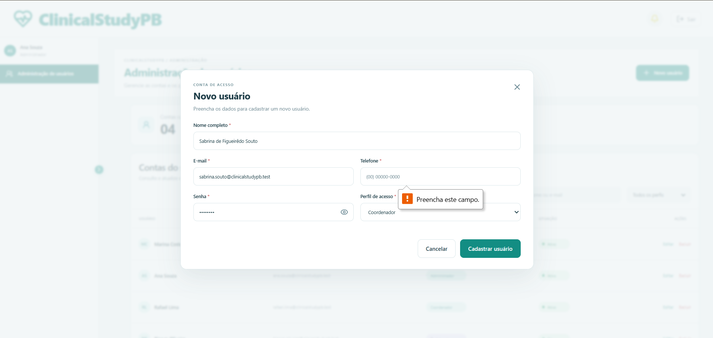

**Figura**: Cadastro de usuário concluído com sucesso.
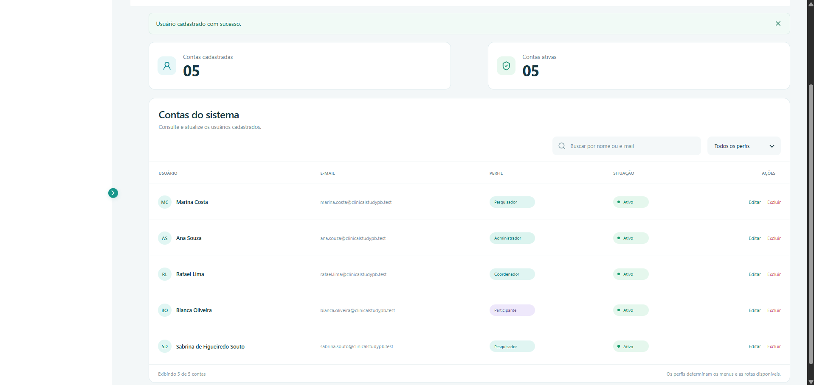

**Figura**: Edição de usuário concluído com sucesso.


### RF02 — Permitir autenticação e encerramento de sessão

**Perfis:** usuários autenticados dos quatro perfis, conforme as permissões do cliente. O login e o logout são atendidos pela API. A web restaura a sessão e protege páginas privadas. O aplicativo mobile disponível no repositório atualmente chama a API para login e logout, mas mantém o estado de sessão somente em memória: não consulta `/auth/me` para restaurá-la e requer novo login após recarregar ou fechar o aplicativo. A prévia mobile ainda não possui interface interativa.

**Figura**: Credenciais inválidas ou erro de autenticação.
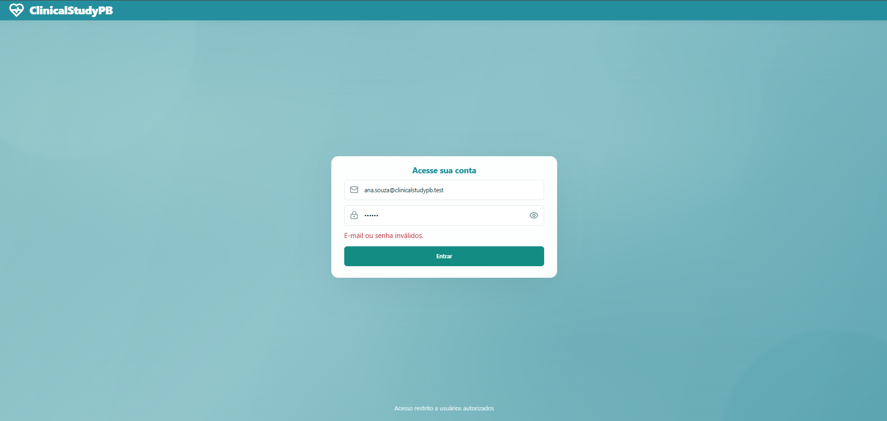

**Figura**: Login bem-sucedido e sessão do adiministrador ativa.
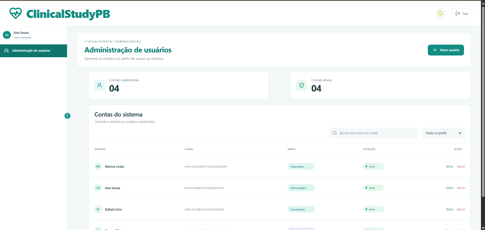

### RF03 — Restringir funcionalidades conforme o perfil

**Perfis:** Administrador, Pesquisador, Coordenador e Participante, com acesso conforme o cliente e a operação. A web restringe navegação, rotas e menus aos perfis Administrador, Pesquisador e Coordenador. A API valida token, sessão, status da conta e perfil nas rotas protegidas. Participante é reconhecido pela API e destinado ao cliente mobile, sem página própria na web. As permissões específicas estão descritas em [Usuários e controle de acesso](./usuarios-e-controle-de-acesso.md).

**Figura**: Acesso negado ou rota restrita por perfil (usuário do tipo participante não consegue acessar o web).
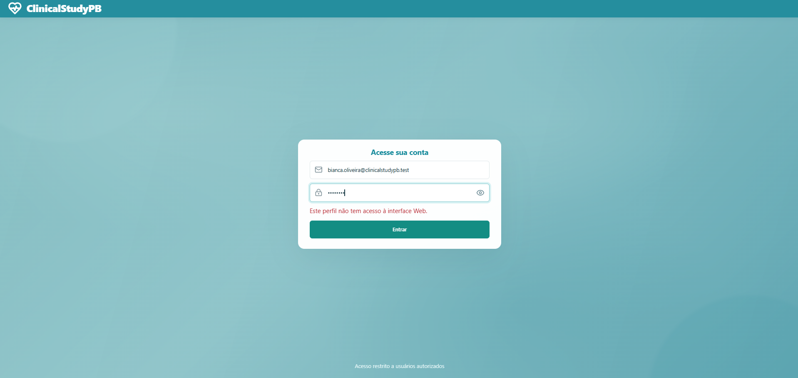

**Figura**: Acesso ao perfil no web permitido ao coordenador.
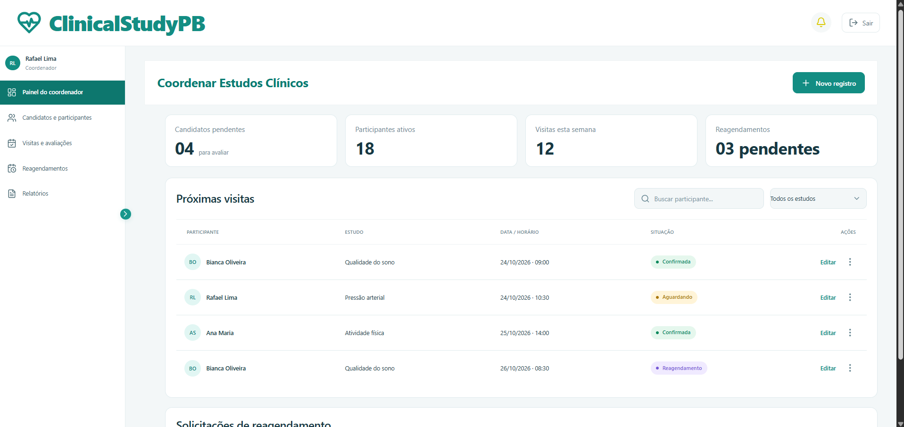

**Figura**: Acesso ao perfil no web permitido ao pesquisador.
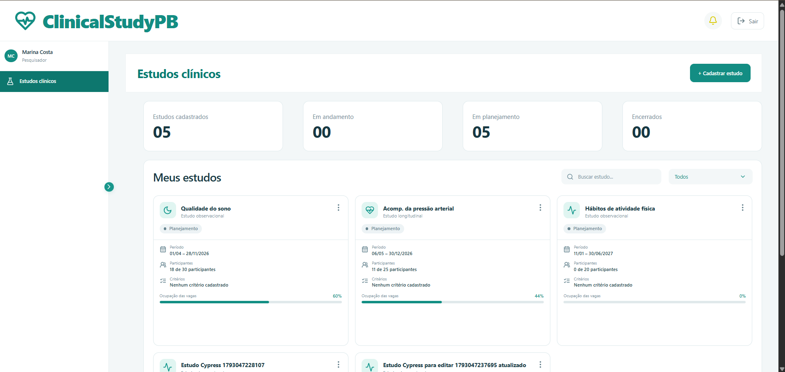

### RF04 — Cadastrar estudos

**Perfil:** Pesquisador. Cadastra, consulta e atualiza estudos próprios. Os dados incluem título, objetivo, responsável, datas e limite de participantes; a API persiste os registros no PostgreSQL e valida os campos e a propriedade do estudo.

**Figura**: Validação de campos obrigatórios.
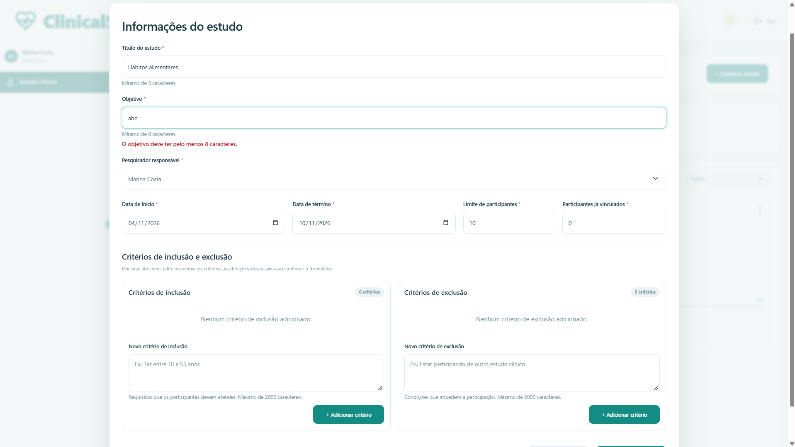

**Figura**: Validação de datas.
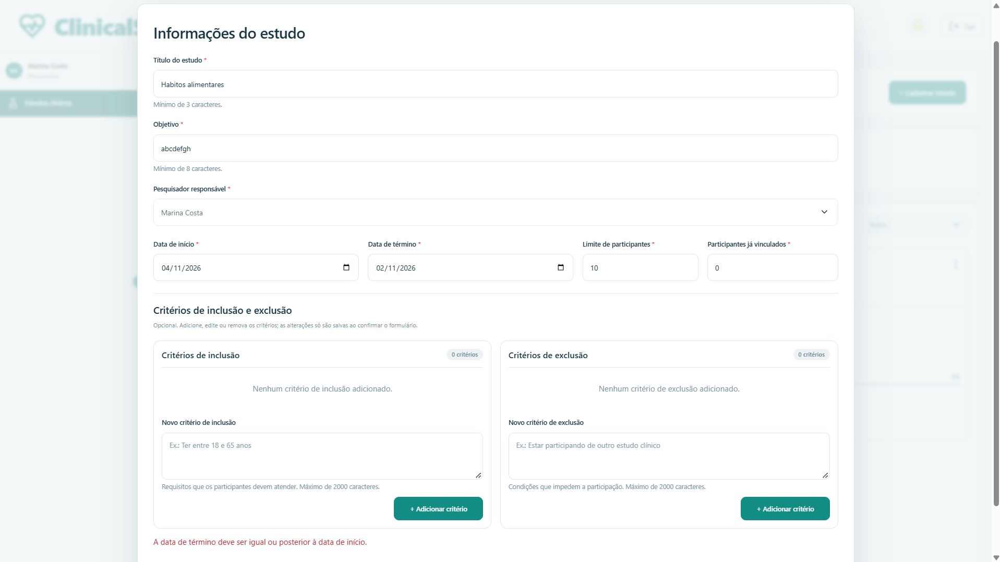

**Figura**: Validação de limite de participantes.
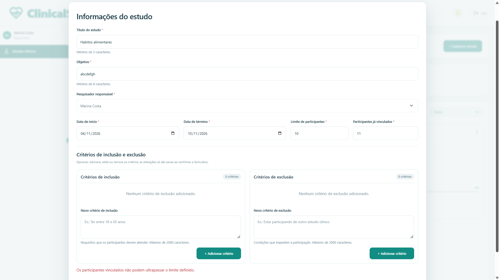

**Figura**: Estudo cadastrado com sucesso.
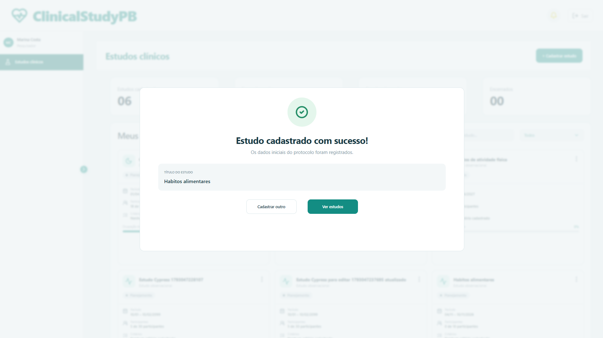

**Figura**: Estudo cadastrado e exibido na listagem/detalhes.
.png)

### RF05 — Definir critérios de inclusão e exclusão

**Perfil:** Pesquisador responsável pelo estudo. Critérios dos tipos **Inclusão** e **Exclusão** podem ser cadastrados, consultados e atualizados por estudo. A API verifica a propriedade do estudo; a interface web permite editar os critérios e apresenta validação de descrição vazia ou acima do limite definido. Os critérios são persistidos no banco.

**Figura**: Critérios de inclusão e exclusão salvos com sucesso.
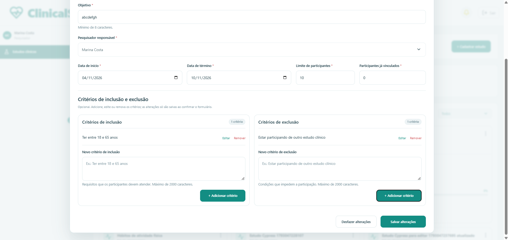

### RF06 — Definir visitas previstas e suas atividades

**Perfil:** Pesquisador responsável pelo estudo. Pode cadastrar e consultar visitas previstas e as atividades associadas a cada visita do estudo. A ordem da visita é única dentro do estudo; os campos obrigatórios e os valores numéricos são validados. Este requisito trata do cronograma previsto, não do agendamento individual de visitas de participantes.

**Figura**: Validação de campos e aviso de ordem de visita duplicada.
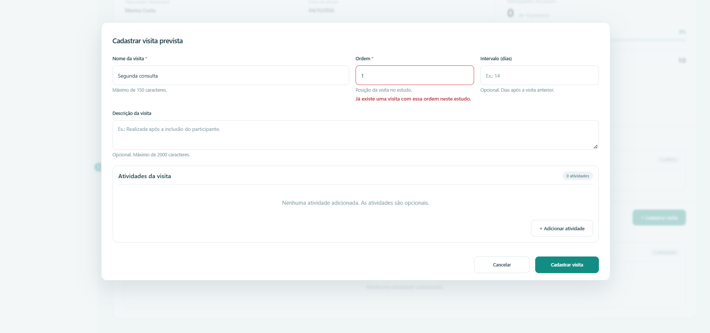

**Figura**: Cadastro de visita e atividades.
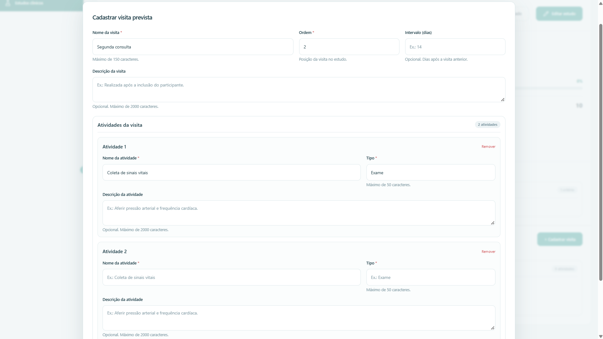

### RF07 — Gerenciar os estados dos estudos

**Perfil:** Pesquisador responsável pelo estudo. Os estados persistidos são **Planejamento**, **Recrutamento**, **Execução** e **Encerrado**. A API permite somente transições sequenciais; estados desconhecidos ou transições inválidas são rejeitados. Estudos encerrados continuam consultáveis, mas não podem ser alterados nem receber novos critérios, visitas ou atividades.

**Figura**: Alteração do estado do estudo. Não é possível fazer transições inválidas ou para estados desconhecidos.
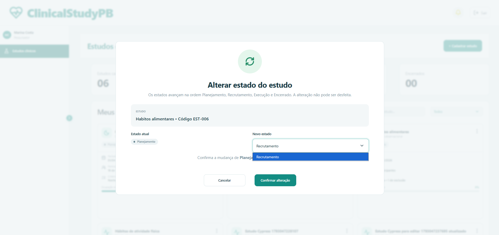

**Figura**: Opções para transição de estado ou edição de estudo não aparecem no estudo encerrado.
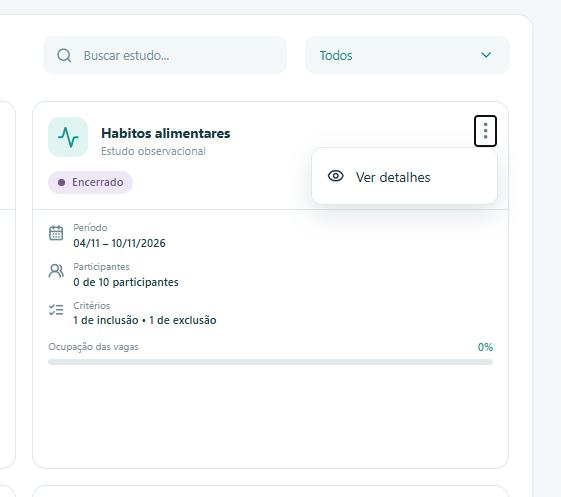

### RF08 – Cadastrar e consultar candidatos

**Perfil:** Coordenador. O sistema permite cadastrar e consultar candidatos vinculados a um estudo. O cadastro exige o nome do candidato, enquanto o e-mail é opcional.

A aplicação web possui interfaces para cadastro e consulta de candidatos no módulo do Coordenador. O backend valida a existência e a propriedade do estudo, impede operações em estudos encerrados e persiste os dados dos candidatos no banco de dados.

**Figura**: Cadastro de candidato.
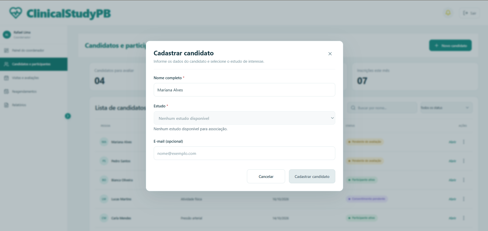

**Figura**: Listagem de candidatos e participantes
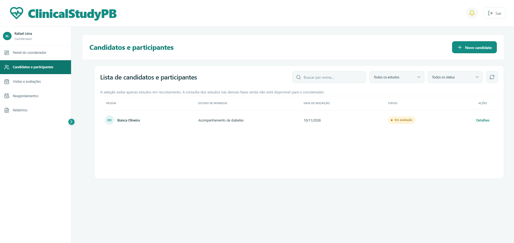

### RF09 – Avaliar a elegibilidade dos candidatos

**Perfil:** Coordenador. O sistema permite registrar e consultar avaliações de elegibilidade dos candidatos, considerando os critérios de inclusão e exclusão definidos para o estudo.

A situação do candidato é determinada pelas avaliações registradas:
- **Elegível:** atende a todos os critérios de inclusão e não atende a nenhum critério de exclusão.
- **Inelegível:** não atende a algum critério de inclusão ou atende a algum critério de exclusão.
- **Em avaliação:** existem avaliações pendentes, sem ocorrência de condição que determine a inelegibilidade.

As avaliações são persistidas no banco de dados, com validação dos critérios vinculados ao estudo e das respostas fornecidas. O backend impede a avaliação de candidatos já incluídos e operações em estudos encerrados.

**Figura**: Tela de avaliação de elegibilidade e consentimento.
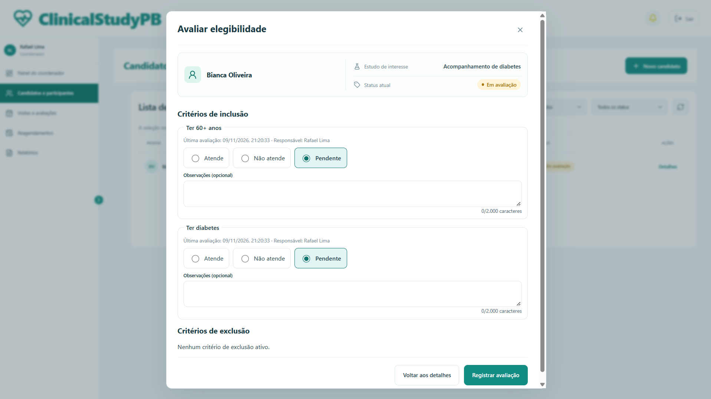

### RF10 – Registrar e consultar o consentimento

**Perfil:** Coordenador. O sistema permite registrar e consultar o estado do consentimento simulado dos candidatos. A API disponibiliza operações para registrar e consultar o consentimento mais recente, mantendo os registros persistidos no banco de dados.

**Figura**: Tela de avaliação de elegibilidade e consentimento.
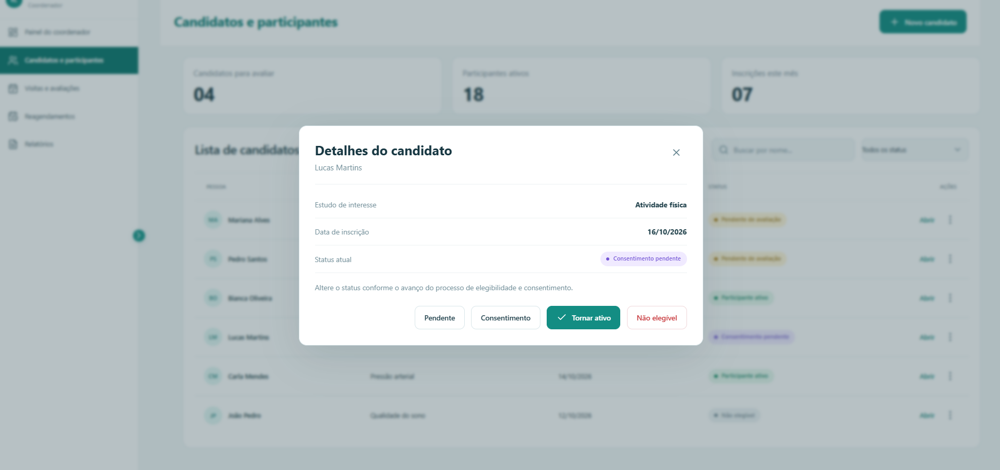

### RF11 – Incluir participantes no estudo

O sistema permite incluir um candidato como participante ativo de um estudo, desde que as condições necessárias sejam atendidas.

Para efetivar a inclusão, o backend verifica se:
- O candidato está classificado como elegível;
- Todos os critérios de elegibilidade foram avaliados;
- O consentimento está registrado;
- O estudo não está encerrado;
- Existe disponibilidade de vagas.

A operação é realizada com controle transacional no banco de dados, impedindo a inclusão quando alguma dessas condições não for atendida. Após a inclusão, o candidato passa a possuir uma participação ativa no estudo.

<!-- Inserir captura Web: ação de inclusão integrada, se disponível. -->
<!-- Inserir captura Web: validação/bloqueio de inclusão, identificando se é demonstrativo ou resposta da API. -->

### Protótipos mobile produzidos na Release 1

Todas as tarefas mobile previstas para a Release 1 foram concluídas. As entregas de consulta de estudos do participante, próximas visitas, histórico de comparecimento e ações de confirmação de presença, solicitação de reagendamento e retirada foram realizadas como protótipos navegáveis no Figma, com estados demonstrativos de sucesso e erro. Esses protótipos não representam integração funcional com a API e não antecipam a entrega dos requisitos mobile RF17–RF20, planejados para releases posteriores.

No código mobile atual está presente uma implementação parcial das telas de login e inicial/conta, além de uma prévia de desenvolvimento com dados fictícios, sem API, disponível nas rotas `/preview`, `/preview/login` e `/preview/inicio`. Os links dos protótipos estão reunidos em [Links úteis](./LINKS-UTEIS.md) e as limitações atuais constam no [README mobile](../../../mobile/README.md).

**Figura**: Protótipo mobile da tela de login do participante no Figma.
<p>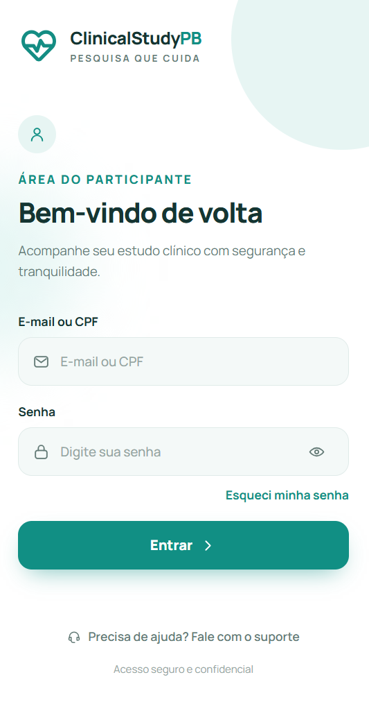</p>

**Figura**: Protótipo mobile da tela inicial do participante no Figma.
<p>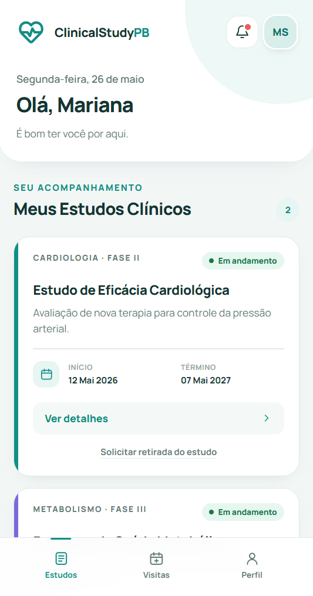</p>

**Figura**: Protótipo mobile da tela de detalhes do estudo no Figma.
<p>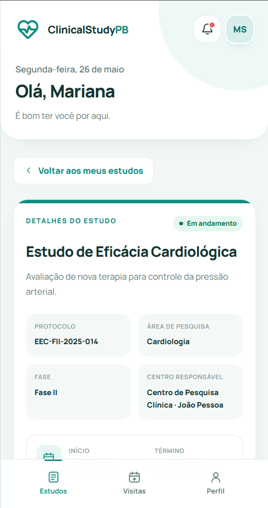</p>

**Figura**: Protótipo mobile da tela de retirada de estudo no Figma.
<p>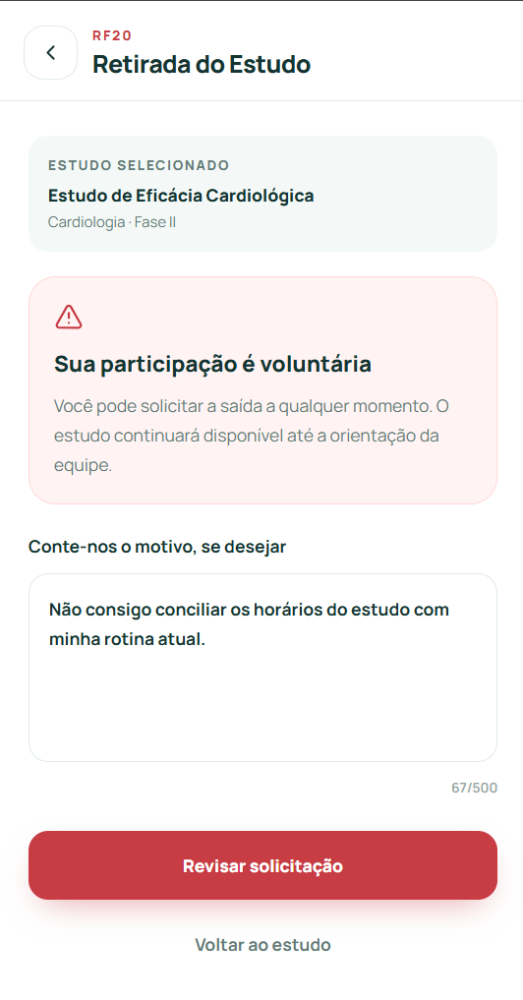</p>

**Figura**: Protótipo mobile da tela de visitas previstas no Figma.
<p>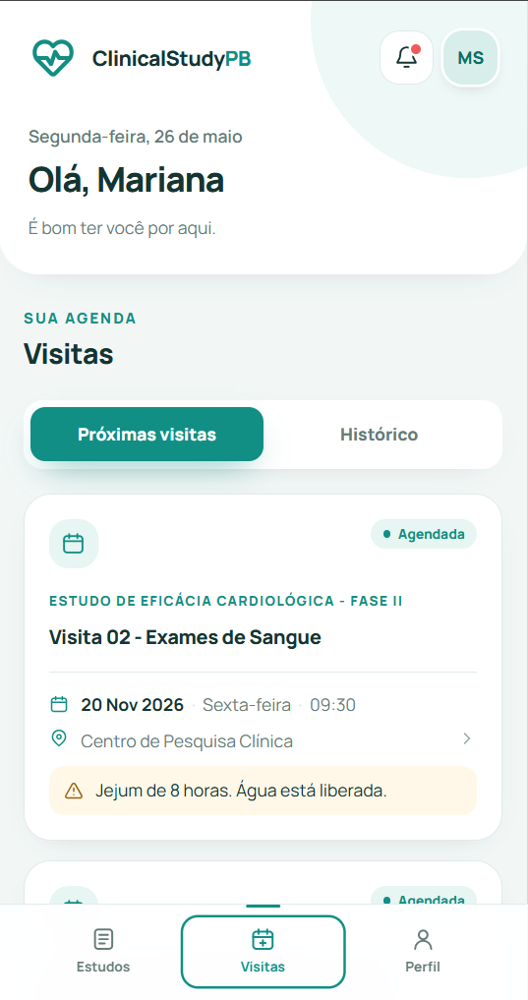</p>

**Figura**: Protótipo mobile da tela de histórico de visitas no Figma.
<p>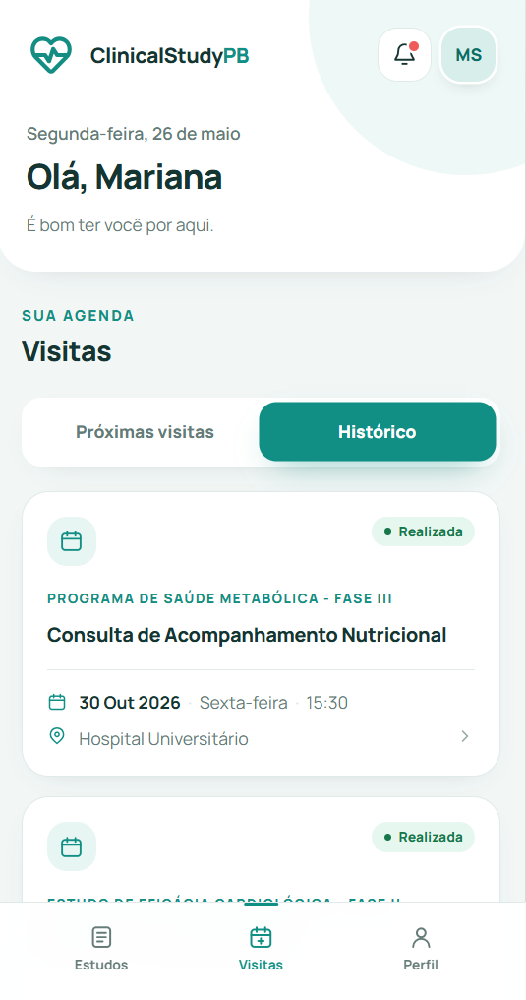</p>

**Figura**: Protótipo mobile da tela de perfil do participante no Figma.
<p>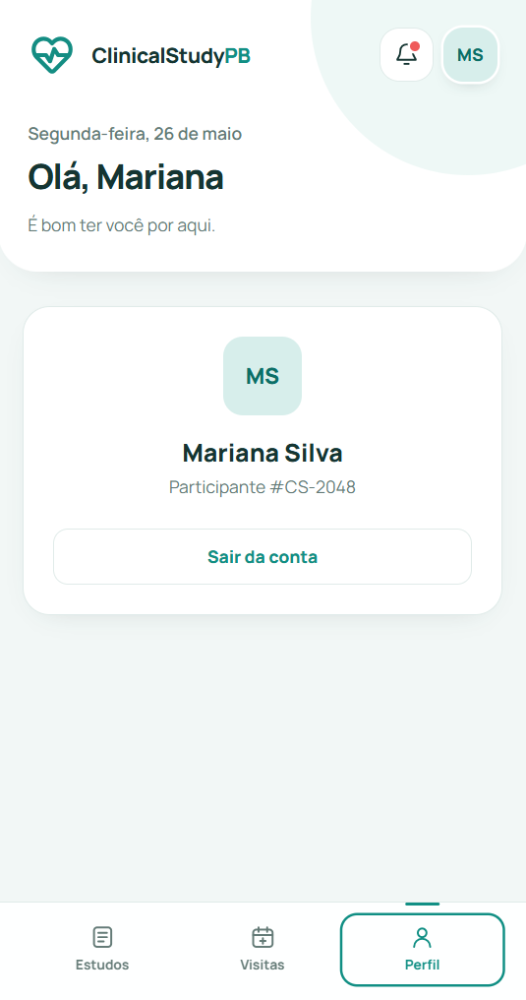</p>


## 4. Tecnologias utilizadas

As versões abaixo foram conferidas nos arquivos de configuração e nos lockfiles disponíveis. A versão do Node.js do backend é declarada como `>=24.15.0 <25`; os workflows web e backend usam Node.js 24.15.0, enquanto o workflow mobile usa Node.js 22.

| Componente | Tecnologias e versões registradas |
|---|---|
| Backend/API | Node.js 24 (mínimo 24.15.0), TypeScript 6.0.3, NestJS 12.1.3, `class-transformer` 0.5.1, `class-validator` 0.15.1, `pg` 8.23.1, Jest 30.5.2 e Supertest 7.3.1. |
| Web | TypeScript 5.9.3, React 19.3.1, React Router 7.18.4, Vite 7.3.7, Vitest 3.2.7, Testing Library 16.3.3, `jest-dom` 6.9.1 e Cypress 16.2.0. |
| Mobile | Expo SDK 58.0.17, Expo Router 58.0.25, React Native 0.88.0, React 19.3.0, Jest 30.5.2, `jest-expo` 58.0.12 e React Native Testing Library 14.1.0. |
| Banco de dados | PostgreSQL 17 (`postgres:17-bookworm` no Compose); migrations SQL e driver `pg`. |
| Execução e integração contínua | `concurrently` 10.0.6, GitHub Actions; Azure Boards/DevOps para organização do trabalho. |

**Pré-requisitos:** Docker Desktop com Docker Compose para a execução integrada; Node.js 24 para os comandos locais do backend e npm; PostgreSQL 17 se o banco não for executado pelo Compose; e Expo Go em dispositivo físico ou um emulador Android para abrir o aplicativo mobile. Para desenvolver ou executar o cliente mobile, instale também as dependências da pasta `mobile/`.

## 5. Instalação e execução

### 5.1. Execução recomendada com Docker Compose

Na raiz do repositório, execute:

```powershell
docker compose up --build
```

O Compose inicia o PostgreSQL, aguarda a disponibilidade do banco, aplica as migrations e executa o seed fictício do backend antes de iniciar a API e a web. Não é necessário criar arquivos `.env` nesse fluxo.

| Serviço | Endereço |
|---|---|
| Aplicação web | `http://localhost:5173` |
| API | `http://localhost:3000` |
| PostgreSQL publicado no host | `localhost:5433` |

O banco do Compose usa a configuração local definida em `compose.yaml`. O volume `postgres_data` é persistente; `docker compose down` encerra os serviços sem apagar o banco. Não use `docker compose down -v` se precisar preservar os dados locais. Os parâmetros de conexão estão detalhados na documentação do [banco de dados](./sprint01/banco_de_dados/README-BD.md).

O Compose não inicia o Expo. Para executar o aplicativo mobile em outro terminal, instale suas dependências (`npm.cmd ci --prefix mobile`) e inicie o Expo com `npm.cmd --prefix mobile run start`. Use o QR code no Expo Go conectado à mesma rede do computador ou um emulador Android configurado.

### 5.2. Execução local sem container para a API e a web

Os comandos a seguir são executados na raiz do repositório. No PowerShell, `npm.cmd` evita bloqueios da política de execução de scripts:

1. Inicie o banco pelo Compose ou disponibilize PostgreSQL 17. Para iniciar somente o serviço de banco:

   ```powershell
   docker compose up -d --wait postgres
   ```

2. Crie os arquivos de ambiente locais:

   ```powershell
   Copy-Item backend\.env.example backend\.env
   Copy-Item web\.env.example web\.env
   ```

   Configure `DATABASE_URL` em `backend\.env`. Para o PostgreSQL do Compose acessado pela máquina host, use a porta `5433`; a configuração de exemplo usa `localhost:5432`. `PORT` define a porta da API (padrão `3000`) e `WEB_ORIGIN` a origem web permitida (padrão `http://localhost:5173`). Em `web\.env`, `VITE_API_URL` indica a URL da API (padrão `http://localhost:3000`). Arquivos `.env` são locais e não devem ser versionados.

3. Instale as dependências usando os lockfiles:

   ```powershell
   npm.cmd ci
   npm.cmd ci --prefix backend
   npm.cmd ci --prefix web
   npm.cmd ci --prefix mobile
   ```

   O script raiz `setup` também está disponível, mas instala a web com `npm install`; os comandos acima usam diretamente os lockfiles de cada aplicação.

4. Aplique as migrations e, se necessário, crie os dados fictícios. O backend exige `DATABASE_URL`. O seed deve ser habilitado explicitamente e não pode ser executado em produção:

   ```powershell
   npm.cmd --prefix backend run db:migrate
   $env:ALLOW_DEMO_SEED = 'true'
   npm.cmd --prefix backend run db:seed:demo
   Remove-Item Env:ALLOW_DEMO_SEED
   ```

   O seed é idempotente, cria contas para os quatro perfis e três estudos fictícios. Ele não popula os dados de recrutamento e execução.

5. Inicie API e web em conjunto:

   ```powershell
   npm.cmd run dev
   ```

   Esse script inicia backend e web. Para executá-los em terminais separados, os scripts existentes são `npm.cmd run dev:backend` e `npm.cmd run dev:web`. O script `npm.cmd run dev:all` inicia o PostgreSQL do Compose e os processos de backend, web e Expo; ele não substitui a aplicação de migrations nem a carga opcional do seed descritas acima.

### 5.3. Aplicativo mobile em dispositivo, emulador e prévia

Com as dependências instaladas, inicie o servidor Expo:

```powershell
npm.cmd --prefix mobile run start
```

No dispositivo físico, abra o projeto pelo QR code no Expo Go e mantenha computador e celular na mesma rede Wi-Fi. A API deve estar acessível pelo dispositivo; se necessário, configure `EXPO_PUBLIC_API_URL` em `mobile\.env` com o endereço de rede do computador e a porta `3000`. No emulador Android, o endereço usual da API é `http://10.0.2.2:3000`. A configuração em desenvolvimento pode detectar o host do Metro; builds fora do desenvolvimento exigem URL explícita do servidor.

O script `npm.cmd --prefix mobile run android` solicita a abertura em um emulador Android. Para testar apenas a interface web/preview mobile, sem iniciar API ou banco:

```powershell
npm.cmd --prefix mobile run web
```

A prévia Expo Web é servida em `http://localhost:8081`; use `/preview`, `/preview/login` ou `/preview/inicio`. O login dessa prévia aceita e-mail válido e senha não vazia, usa dados fictícios e não faz chamadas à API. Atualmente a prévia contém somente Login e Inicial da conta; as demais telas previstas no Figma não estão no código.

### 5.4. Credenciais fictícias de demonstração

As contas abaixo são dados fictícios para ambiente local. O seed precisa ter sido executado para que estejam disponíveis:

| Perfil | E-mail | Senha |
|---|---|---|
| Administrador | `ana.souza@clinicalstudypb.test` | `Admin123!` |
| Pesquisador | `marina.costa@clinicalstudypb.test` | `Demo123!` |
| Coordenador | `rafael.lima@clinicalstudypb.test` | `Demo123!` |
| Participante | `bianca.oliveira@clinicalstudypb.test` | `Demo123!` |

Use essas credenciais somente em desenvolvimento. Mais detalhes sobre migrations, seed e conexão estão em [Banco de dados](./sprint01/banco_de_dados/README-BD.md); os comandos de cada aplicação também estão nos [READMEs do backend](../../../backend/README.md) e [mobile](../../../mobile/README.md).

## 6. Testes e cobertura

A estratégia de QA contempla os requisitos RF05 a RF11, com o objetivo de verificar o comportamento esperado das funcionalidades, suas regras de negócio, validações, permissões e integridade das operações.

A validação está organizada em dois documentos complementares:

- **[Checklist de testes funcionais — RF05 a RF11](./docs/releases/release1/sprint02/checklist-rf05-rf11.md):** reúne os cenários funcionais, contemplando fluxos positivos, validações, situações de erro e comportamentos esperados. Seu objetivo é acompanhar a verificação dos requisitos e garantir que as principais situações de uso sejam consideradas.
- **[Relatório de cobertura dos testes automatizados](./docs/releases/release1/sprint02/relatorio-cobertura-testes-automatizados.md):** apresenta as tecnologias utilizadas, os tipos de testes, os resultados das execuções, os percentuais de cobertura de código e os pontos que ainda precisam de maior validação.

**Resultados preliminares — 09/11/2026**

| Indicador | Backend (Jest) | Frontend (Vitest) |
|---|---:|---:|
| Testes aprovados | 205 | 532 |
| Suítes executadas | 23 | — |
| Cobertura de instruções | 92,63% | 96,29% |
| Cobertura de ramificações | 82,80% | 93,51% |
| Cobertura de funções | 99,32% | 87,65% |
| Cobertura de linhas | 94,73% | 96,29% |

Os resultados demonstram uma cobertura expressiva do código automatizado. Os percentuais representam a cobertura do código executado pelos testes, não a porcentagem de requisitos funcionais concluídos.

## 7. Documentação da API

A documentação interativa da API é disponibilizada por meio do Swagger UI, permitindo consultar os endpoints, visualizar parâmetros e modelos de requisição e resposta, além de executar operações.

Com o backend em execução, a documentação pode ser acessada em:

- **Swagger UI:** [http://localhost:3000/api](http://localhost:3000/api)
- **Especificação OpenAPI (JSON):** [http://localhost:3000/api-json](http://localhost:3000/api-json)

Caso a variável `PORT` esteja configurada com outro valor, deve-se substituir `3000` pela porta utilizada.

As rotas protegidas utilizam autenticação HTTP Bearer com o token JWT retornado pelo endpoint `POST /auth/login`. Para testar essas operações pelo Swagger UI, deve-se realizar o login, copiar o valor de `accessToken` e informá-lo na opção **Authorize**.

Informações complementares sobre os endpoints, parâmetros, validações e permissões estão disponíveis no [README do backend](../../../backend/README.md).

## 8. Processo de desenvolvimento

### Sprint 1

- **Período planejado:** 13/10/2026 a 26/10/2026.
- **Objetivo:** estabelecer arquitetura e ambientes, implementar RF01–RF04 na web e preparar protótipos navegáveis web/mobile.
- **Esforço registrado no planejamento específico:** 240 horas.

As atividades abrangeram estrutura e arquitetura, ambiente da API/PostgreSQL/web/mobile e CI, usuários (RF01), autenticação (RF02), permissões (RF03), estudos (RF04), protótipos, testes e documentação. O acompanhamento foi planejado no Azure Boards, com atualização de responsáveis, tarefas e impedimentos, revisão das entregas e retrospectiva em 26/10.

Na retrospectiva, a equipe registrou como pontos positivos a liderança, a definição inicial da arquitetura e a colaboração. Como melhorias, apontou descrições mais claras das tarefas, comunicação e integração contínuas e definição mais explícita dos papéis. Para a sprint seguinte, foram propostas a criação de um canal de avisos e a aprovação de pelo menos dois integrantes antes de integrar alterações à branch principal. Consulte o [planejamento](./sprint01/planejamento.md) e a [retrospectiva](./sprint01/retrospectiva.md).

**Figura**: Burndown da Sprint 1.
<p>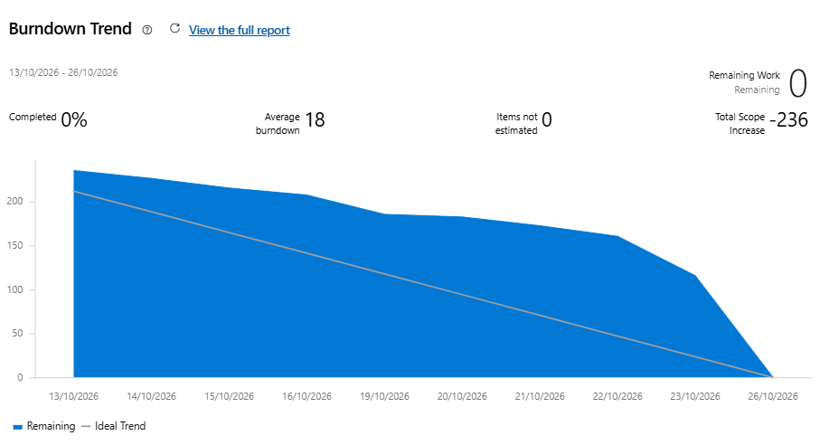</p>

### Sprint 2

- **Período planejado:** 27/10/2026 a 09/11/2026.
- **Objetivo:** completar o fluxo de recrutamento e inclusão, com RF05–RF11, integração web/API/banco, continuidade dos protótipos mobile, qualidade e consolidação da documentação.
- **Esforço planejado:** 187 horas.

O backlog inclui critérios de inclusão e exclusão, visitas previstas e atividades, transições de estado, candidatos, avaliação de elegibilidade, consentimento simulado e inclusão sujeita à elegibilidade, consentimento e limite de vagas. Também prevê revisão de contratos da API, testes, pipeline, integração e estudo de viabilidade do AWS EC2 Free Tier, sem exigir implantação. A distribuição de tarefas e responsáveis está no [planejamento da Sprint 2](./sprint02/planejamento.md).

O acompanhamento foi planejado no Azure DevOps, com atualização de responsáveis, dependências, andamento e impedimentos. Para a organização da sprint, foi realizada uma reunião de acompanhamento em 02/11 e uma revisão das entregas e retrospectiva em 08/11, com a conclusão da Release 1 prevista para 09/11. Consulte o [planejamento](./sprint02/planejamento.md) e a [retrospectiva](./sprint02/retrospectiva.md).

**Figura**: Burndown da Sprint 2.
<!-- Inserir o burndown da Sprint 2. -->
<p>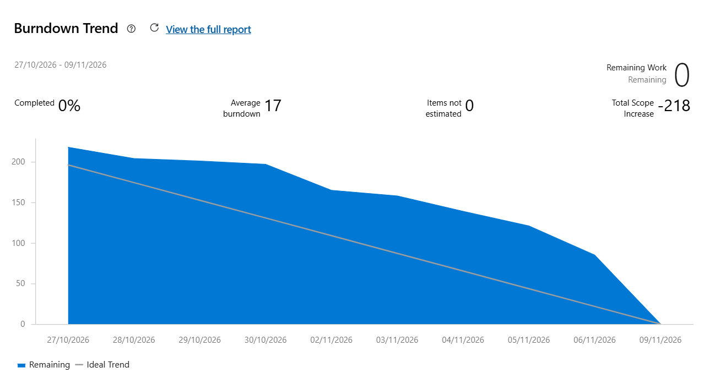</p>

## 9. Documentação complementar

### Planejamento e acompanhamento

- [Contexto e requisitos do projeto](../../../.github/contexto.md)
- [Plano de trabalho da equipe](../../../.github/ClinicalStudyPB%20-%20Plano%20de%20Trabalho.md)
- [Sprint 1 — Planejamento](./sprint01/planejamento.md)
- [Sprint 1 — Retrospectiva](./sprint01/retrospectiva.md)
- [Sprint 2 — Planejamento e backlog](./sprint02/planejamento.md)
- [Sprint 2 — Retrospectiva](./sprint02/retrospectiva.md)

### Arquitetura, dados e acesso

- [Arquitetura e integração](./arquitetura-e-integracao.md)
- [Banco de dados, migrations e seed](./sprint01/banco_de_dados/README-BD.md)
- [Usuários e controle de acesso](./usuarios-e-controle-de-acesso.md)

### Testes, execução e protótipos

- [Documentação de testes](./sprint01/testes/README-TESTES.md)
- [README principal](../../../README.md)
- [README do backend](../../../backend/README.md)
- [README mobile](../../../mobile/README.md)
- [Links úteis, incluindo protótipos Figma](./LINKS-UTEIS.md)