# ClinicalStudyPB — Release 2

- **Período:** 10/11/2026 a 07/12/2026
- **Sprints:** 3 e 4
- **Escopo funcional:** RF12 a RF22
- **Situação:** Sprint 3 encerrada em 23/11/2026; Sprint 4 planejada, sem resultados registrados no repositório

## 1. Apresentação do projeto

O ClinicalStudyPB — Sistema de Gestão de Estudos Clínicos é um projeto acadêmico da disciplina de Engenharia de Software II (2026.2). O sistema apoia o ciclo operacional de estudos clínicos com dados fictícios e não realiza diagnóstico nem decisão clínica automatizada.

A Release 1 (RF01–RF11) entregou usuários, autenticação, estudos e recrutamento na aplicação web. A **Release 2 — Acompanhamento e Mobile** cobre o que acontece depois da inclusão do participante:

- **Acompanhamento (RF12–RF16):** agendamento de visitas, situação das visitas, resultados das avaliações, histórico e retirada.
- **Aplicativo do participante (RF17–RF20):** consulta de estudos e visitas, confirmação de presença, reagendamento e retirada voluntária.
- **Monitoramento (RF21–RF22):** painel e relatórios.

A Sprint 3 concentrou RF12–RF18. RF19–RF22 pertencem à Sprint 4.

| Perfil | Funcionalidades e acesso na Release 2 (situação ao fim da Sprint 3) |
|---|---|
| Administrador | Mantém a gestão de usuários e perfis da Release 1. Não acessa as rotas de acompanhamento. |
| Pesquisador | Nos estudos próprios: consulta as visitas agendadas, registra os resultados fictícios das avaliações (RF14) e consulta o histórico dos participantes (RF15), pela página de estudos. Estudos encerrados ficam somente para leitura. |
| Coordenador | Consulta os participantes incluídos, agenda visitas (RF12), atualiza a situação das visitas (RF13), consulta resultados sem registrá-los, consulta o histórico (RF15) e registra a retirada (RF16). As telas de reagendamentos e relatórios ainda usam dados demonstrativos (RF19–RF22). |
| Participante | Usa o aplicativo mobile com login exclusivo do perfil, sessão em armazenamento seguro e restauração ao reabrir o app. Consulta os próprios estudos (RF17) e as próximas visitas e o histórico de comparecimento (RF18) pela API. Confirmação de presença, reagendamento e retirada voluntária são apenas prévias de interface (Sprint 4). |

As permissões por perfil e a forma de identificar o participante estão em [Matriz de acesso e identificação do participante](./Sprint03/matriz-acesso-e-identificacao-participante-rf12-rf18.md).

### Equipe e papéis

| Papel | Sprint 3 | Sprint 4 |
|---|---|---|
| Líder técnico / Gerente | Zeton | A definir no planejamento da Sprint 4 |
| Backend | Laryssa | A definir |
| Web 1 — estudos, protocolos e usuários | Marcella | A definir |
| Web 2 — recrutamento, visitas e relatórios | Sonally | A definir |
| Mobile | Lethycia | A definir |
| QA / DevOps | Letícia | A definir |

A alocação da Sprint 3 segue o [planejamento da Sprint 3](./Sprint03/planejamento.md). O planejamento da Sprint 4 ainda não está no repositório.

## 2. Arquitetura do sistema

A arquitetura da Release 1 foi mantida. As mudanças da Release 2 ficam nos módulos de acompanhamento e na integração do aplicativo mobile:

- **Aplicação web:** React 19 e TypeScript com Vite. Atende Administrador, Pesquisador e Coordenador. A Sprint 3 acrescentou:
  - a rota `/coordenador/participantes`;
  - os fluxos de acompanhamento em `/coordenador/visitas`;
  - as seções de visitas agendadas e histórico na página de estudos do Pesquisador.

  Os clientes HTTP ficam em `web/src/visits/` e `web/src/participants/`.
- **Aplicativo mobile:** React Native com Expo SDK 58 e Expo Router, exclusivo do perfil Participante. O `AuthContext` valida a sessão com `GET /auth/me`, guarda o token em `expo-secure-store` e oferece um cliente HTTP autenticado compartilhado (`mobile/src/api/http.ts`). Esse cliente é usado pelas consultas `GET /me/studies` e `GET /me/visits`.
- **Backend/API:** NestJS em TypeScript, com sessões, autorização por perfil (`AccessTokenGuard`, `RolesGuard`), validação por DTO e SQL parametrizado. A Sprint 3 acrescentou:
  - `ParticipantVisitsController` (E01–E08);
  - `ParticipantSelfServiceController` (E09–E10);
  - a rota `GET /studies/acompanhamento`;
  - a leitura de visitas previstas e atividades pelo Coordenador (X02/X03).
- **Banco de dados:** PostgreSQL 17 com driver `pg` e migrations SQL, sem ORM. A Sprint 3 usou tabelas já existentes (`participacoes_estudo`, `visitas`, `resultados_avaliacao`) e acrescentou a migration `017_activity_order.sql`, que define a ordem das atividades de cada visita.

Web e mobile acessam o banco somente pela API REST. Autorização e isolamento de dados são aplicados no backend. O participante é identificado pelo token da sessão, nunca por identificadores enviados pelo cliente.

Detalhes de integração estão em [Arquitetura e integração](../release1/arquitetura-e-integracao.md) e em [Diagramas de arquitetura e sequência RF12–RF18](./Sprint03/diagramas-arquitetura-sequencia-rf12-rf18.md).

### 2.1 Diagramas

#### 2.1.1 Diagrama de arquitetura

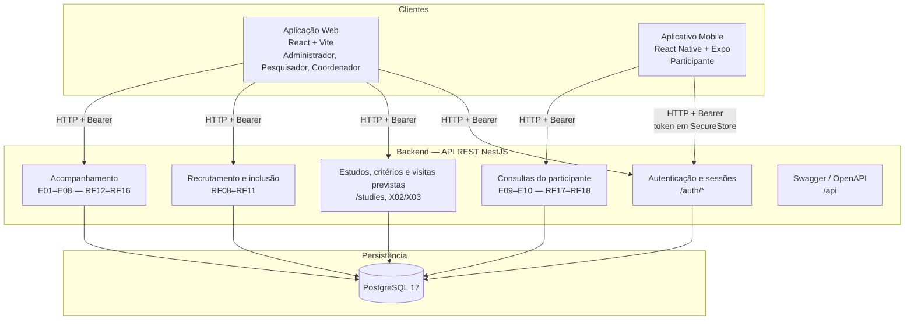

#### 2.1.2 Modelo de dados do acompanhamento

O diagrama mostra apenas as tabelas usadas por RF12–RF18 e a tabela reservada para RF19. O modelo completo está na [documentação do banco de dados](../release1/sprint01/banco_de_dados/README-BD.md).

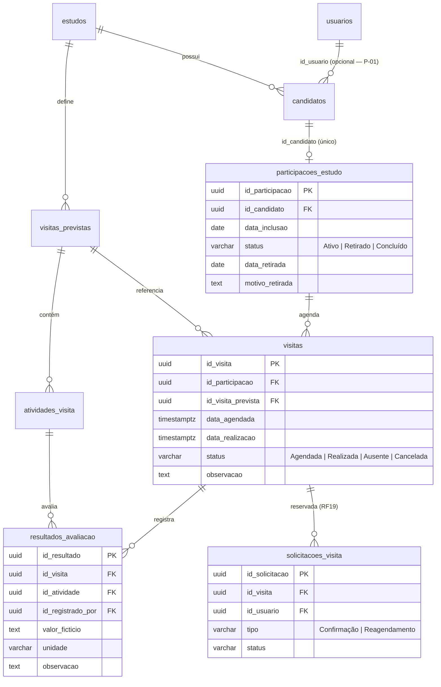

#### 2.1.3 Diagramas de sequência

**Agendamento e atualização da situação da visita na web (RF12–RF13):**

```mermaid
sequenceDiagram
    actor Coordenador
    participant Web as Aplicação Web
    participant API as API NestJS
    participant DB as PostgreSQL

    Coordenador->>Web: Seleciona estudo e participante
    Web->>API: GET /studies/{studyId}/participants (E01)
    Web->>API: GET /studies/{studyId}/visits (X02)
    API->>DB: Participações ativas e visitas previstas do estudo
    API-->>Web: Listas autorizadas
    Coordenador->>Web: Informa visita prevista, data e observação
    Web->>API: POST /studies/{studyId}/scheduled-visits (E02)
    API->>DB: Valida participação ativa, período e duplicidade; grava "Agendada"
    API-->>Web: 201 — visita agendada
    Coordenador->>Web: Registra "Realizada" com data de realização
    Web->>API: PATCH /studies/{studyId}/scheduled-visits/{id}/status (E04)
    API->>DB: Valida transição e data; atualiza em transação
    API-->>Web: 200 — situação atualizada
    Web->>API: GET /studies/{studyId}/scheduled-visits (E03)
    API-->>Web: Agenda atualizada
```

**Consulta de estudos e visitas no aplicativo (RF17–RF18):**

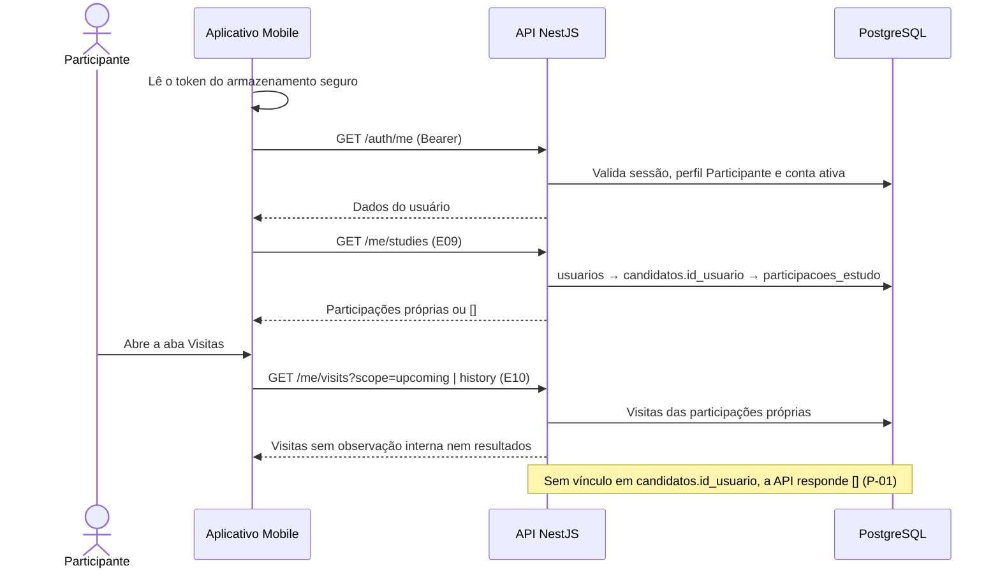

## 3. Funcionalidades implementadas

As descrições abaixo usam estas classificações:

| Classificação | Significado |
|---|---|
| **Implementado e integrado** | Interface e API operam com o PostgreSQL, com testes automatizados executados. |
| **Implementado, com pendência de uso real** | Código integrado à API, mas o fluxo completo depende de uma pendência externa ao requisito. |
| **Parcial** | Parte do comportamento usa a API e parte é demonstrativa. |
| **Tela visual** | Interface sem envio de operações à API. |
| **Pendente** | Sem implementação funcional. |

| Requisito | Sprint | Situação |
|---|---|---|
| RF12 — Agendar visitas | 3 | Implementado e integrado |
| RF13 — Registrar realização, ausência ou cancelamento | 3 | Implementado e integrado |
| RF14 — Registrar resultados fictícios | 3 | Implementado e integrado |
| RF15 — Consultar histórico | 3 | Implementado e integrado |
| RF16 — Registrar retirada | 3 | Implementado e integrado |
| RF17 — Estudos do participante no aplicativo | 3 | Implementado, com pendência de uso real (P-01) |
| RF18 — Próximas visitas e histórico no aplicativo | 3 | Implementado, com pendência de uso real (P-01) e problemas conhecidos |
| RF19 — Confirmar presença ou solicitar reagendamento | 4 | Tela visual |
| RF20 — Solicitar retirada voluntária | 4 | Tela visual |
| RF21 — Painel de monitoramento | 4 | Parcial |
| RF22 — Relatório de recrutamento e acompanhamento | 4 | Tela visual |

Os endpoints E01–E10 e X02/X03 estão definidos em [Contratos da API RF12–RF18](./Sprint03/contratos-api-rf12-rf18.md).

### Módulo D — Acompanhamento

#### RF12 — Agendar visitas para os participantes incluídos

**Perfil:** Coordenador; Pesquisador responsável pelo estudo. **Situação:** implementado e integrado.

- **Onde está:** `/coordenador/visitas` (`ScheduleVisitForm`) e `/coordenador/participantes` (`ParticipantSchedulePanel`), na web; `POST`, `GET /studies/{studyId}/scheduled-visits` (E02, E03) e `GET /studies/{studyId}/participants` (E01), na API.
- **Comportamento:** o usuário escolhe estudo, participante com participação ativa, visita prevista, data e horário. A visita é criada como **Agendada**.
- **Validações:**
  - participação ativa (`PARTICIPATION_NOT_ACTIVE`);
  - visita prevista do mesmo estudo;
  - data entre a inclusão e o término do estudo, pelo dia civil de Brasília;
  - nenhum agendamento ativo da mesma visita prevista, inclusive sob concorrência;
  - observação de até 2.000 caracteres.

  Ausências e cancelamentos permitem remarcar.
- **Limitação:** `/coordenador/visitas` lista apenas estudos em recrutamento. Estudos em execução são atendidos pela rota `/coordenador/participantes`, que usa `GET /studies/acompanhamento`.

**Figura:** Agendamento com visita prevista selecionada.
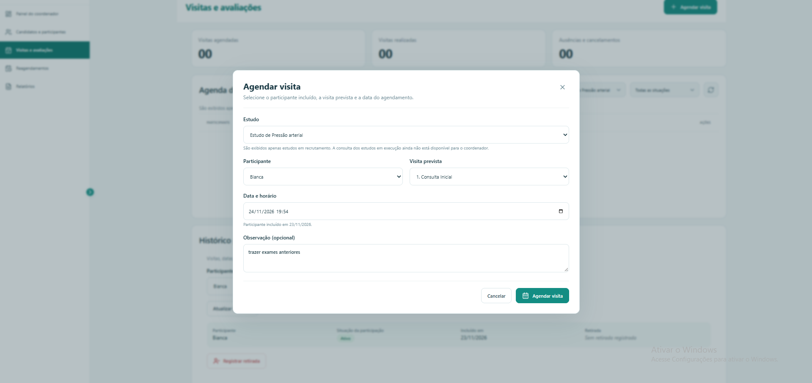

**Figura:** Validação do agendamento sem visita prevista.
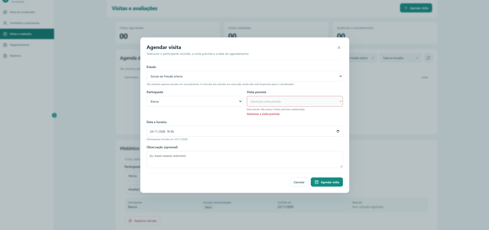

**Figura:** Visita agendada.
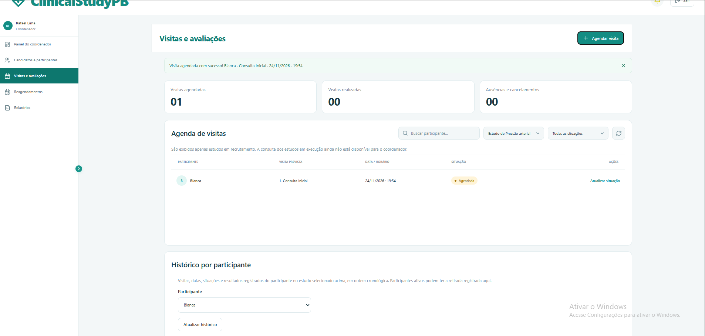

#### RF13 — Registrar realização, ausência ou cancelamento de visitas

**Perfil:** Coordenador; Pesquisador responsável. **Situação:** implementado e integrado.

- **Onde está:** `VisitStatusForm` e `ParticipantSchedulePanel`, na web; `PATCH /studies/{studyId}/scheduled-visits/{id}/status` (E04), na API.
- **Comportamento:** uma visita **Agendada** passa para **Realizada**, **Ausente** ou **Cancelada**. A interface só confirma a mudança após a resposta da API. Visitas em situação final ficam somente para consulta.
- **Validações:**
  - **Realizada** exige data de realização, não futura e dentro do período (`REALIZED_AT_INVALID`);
  - situação final não pode ser alterada (`VISIT_STATUS_FINAL`);
  - participação ativa, autorização e estado do estudo.

  Atualizações concorrentes são serializadas, e falhas do banco revertem a transação.

**Figura:** Coordenador atualizando a situação da visita.
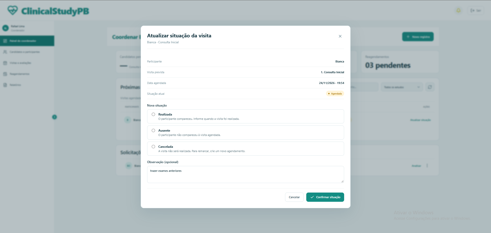

**Figura:** Visita cancelada pelo Coordenador.
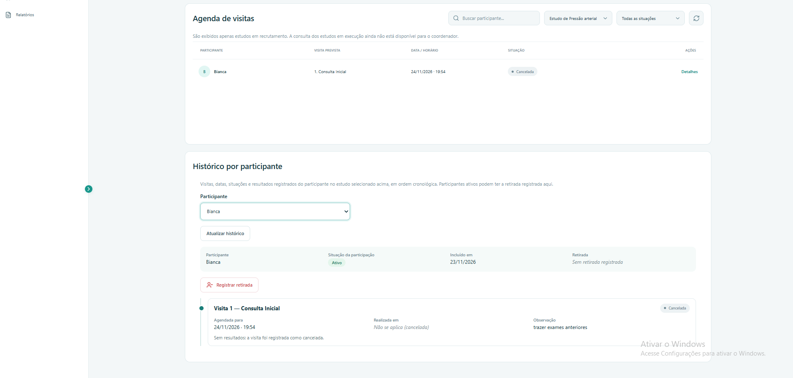

**Figura:** Visita cancelada pelo Coordenador, vista na página do Pesquisador.
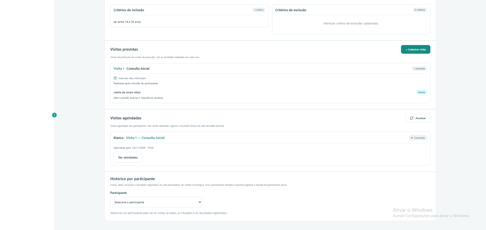

#### RF14 — Registrar resultados fictícios das avaliações previstas

**Perfil:** Pesquisador responsável registra; Coordenador consulta. **Situação:** implementado e integrado.

- **Onde está:** `StudyScheduledVisitsSection` e `VisitResultsPanel`, na página de estudos do Pesquisador; consulta pelo Coordenador em `/coordenador/visitas`. Na API: `GET` e `POST /studies/{studyId}/scheduled-visits/{id}/results` (E05, E06).
- **Comportamento:** para uma visita **Realizada**, o sistema lista as atividades previstas na ordem de cadastro e permite registrar valor fictício, unidade e observação. Os campos ficam persistidos em `resultados_avaliacao`, junto com o responsável pelo registro.
- **Validações:**
  - atividade da visita prevista correspondente (`ACTIVITY_NOT_IN_VISIT`);
  - um resultado por visita e atividade (HTTP 409);
  - visita realizada e estudo não encerrado.

  Registros concorrentes são serializados.

**Figura:** Visitas previstas, visitas agendadas e histórico na página de estudos do Pesquisador.
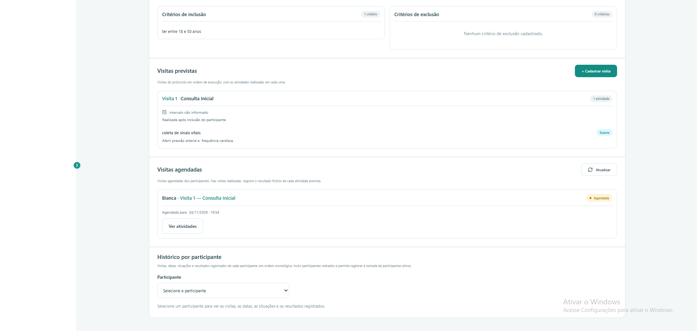

#### RF15 — Consultar histórico de visitas e avaliações de um participante

**Perfil:** Coordenador; Pesquisador responsável. **Situação:** implementado e integrado.

- **Onde está:** `ParticipantHistoryPanel`, em `/coordenador/visitas`, `/coordenador/participantes` e na página de estudos do Pesquisador. Na API: `GET /studies/{studyId}/participants/{participationId}/history` (E07).
- **Comportamento:** exibe a participação, com situação, inclusão e retirada, e as visitas em ordem cronológica, com datas, situações e resultados. Trata histórico vazio e visitas sem resultados. Participantes retirados continuam consultáveis.

**Figura:** Visitas e avaliações do Coordenador, com o histórico por participante.
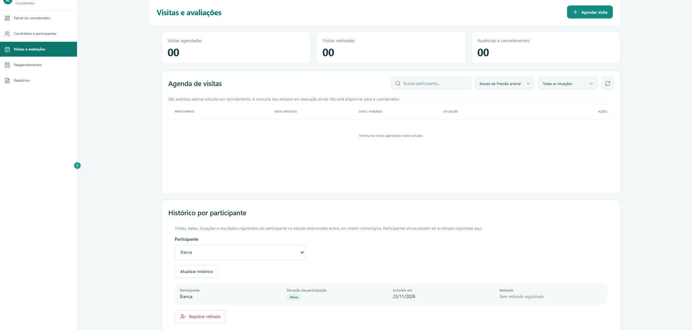

#### RF16 — Registrar retirada de participante do estudo

**Perfil:** Coordenador; Pesquisador responsável. **Situação:** implementado e integrado.

- **Onde está:** `WithdrawalForm` e `WithdrawalPanel`, na web; `POST /studies/{studyId}/participants/{participationId}/withdrawal` (E08), na API.
- **Comportamento:** registra data e motivo, pede confirmação e altera a participação para **Retirado**. Visitas e resultados anteriores são preservados.
- **Validações:**
  - motivo obrigatório;
  - data entre a inclusão e o dia atual;
  - somente participação ativa;
  - perfis autorizados.

  A ação não é oferecida em estudo encerrado nem para participante concluído. Retiradas concorrentes são serializadas.

### Módulo E — Aplicativo do participante

#### Autenticação e sessão no Mobile

Base para RF17–RF20, concluída na Sprint 3. O login aceita somente contas ativas do perfil Participante. O token fica em `expo-secure-store` e é validado com `GET /auth/me` ao reabrir o aplicativo. O logout revoga a sessão na API. Um erro 401 numa consulta encerra a sessão local uma única vez e leva ao login.

No primeiro acesso, o aplicativo também apresenta um **termo de consentimento do participante**, cujo aceite fica só em memória, sem envio à API. Esse recurso não pertence a RF17–RF20 e não substitui o consentimento simulado do RF10, que é registrado na web.

**Figura:** Primeiro acesso do participante.
<p>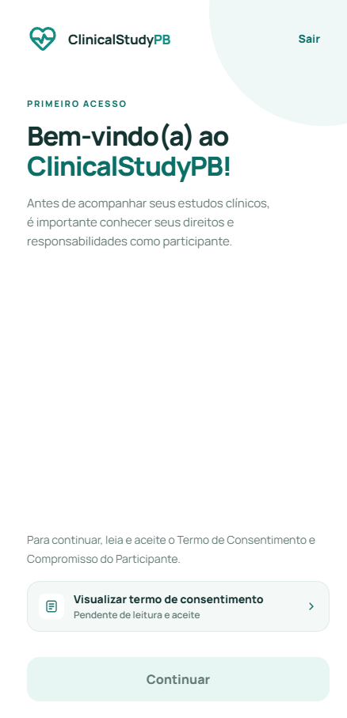</p>

**Figura:** Termo de consentimento no aplicativo.
<p>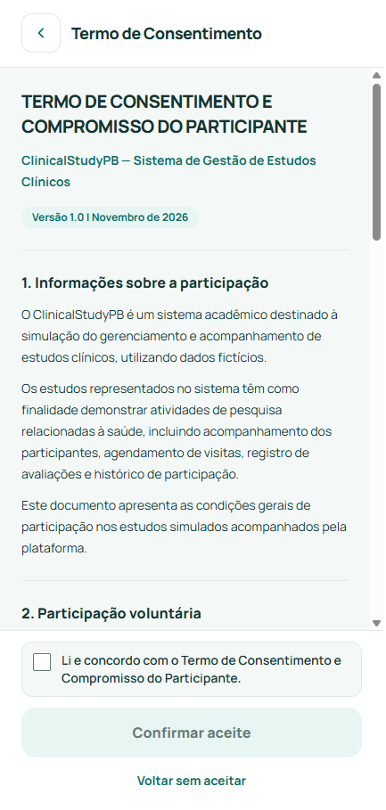</p>

#### RF17 — Permitir ao participante consultar os estudos em que está incluído

**Perfil:** Participante. **Situação:** implementado e integrado à API, com pendência de uso real (P-01).

- **Onde está:** `HomeScreen`, `StudyDetailsScreen`, `useParticipantStudies` e `participantStudiesApi.ts`, no mobile; `GET /me/studies` (E09), na API.
- **Comportamento:** lista as participações próprias (Ativo, Retirado, Concluído) com código, título, objetivo, período, pesquisador e situação, e permite abrir os detalhes. Trata carregamento, lista vazia, erro com nova tentativa e sessão expirada. A resposta da API é validada antes da exibição.
- **Integração comprovada:** testes E2E do backend com PostgreSQL e uma validação manual no Expo Web contra a API real, registrada em 22/11 ([s3-mob-03-validacao.json](./Sprint03/evidencias/s3-mob-03-validacao.json)).
- **Limitação:** a API encontra o participante por `candidatos.id_usuario`, que o cadastro de candidatos não preenche (P-01). Os vínculos usados nos testes e na validação foram criados fora do fluxo do sistema.

**Figura:** Tela inicial do aplicativo após o aceite do termo, com a mensagem "Você ainda não participa de nenhum estudo". Nas evidências da equipe de 23/11, uma participante com o mesmo nome aparece como ativa na web (figura do RF15); o resultado vazio no aplicativo é coerente com a P-01.
<p>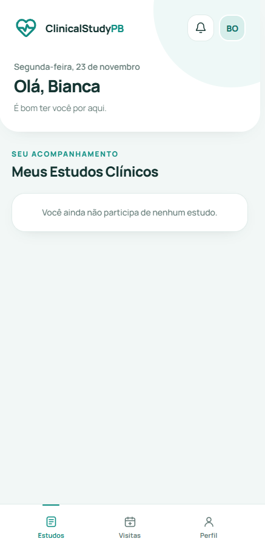</p>

#### RF18 — Exibir próximas visitas e histórico de comparecimento

**Perfil:** Participante. **Situação:** implementado e integrado à API, com pendência de uso real (P-01) e problemas conhecidos.

- **Onde está:** `VisitsScreen`, `VisitDetailsScreen`, `VisitsContext` e `participantVisitsApi.ts`, no mobile; `GET /me/visits?scope=upcoming|history` (E10), na API.
- **Comportamento:**
  - **Próximas visitas:** visitas **Agendadas** com data futura, em ordem crescente.
  - **Histórico:** visitas **Realizadas**, **Ausentes** e **Canceladas**, em ordem decrescente.

  A resposta não inclui observação interna nem resultados de avaliação. O aplicativo trata listas vazias, erro com nova tentativa e troca de sessão.
- **Problemas conhecidos (seção 8):**
  - visitas **Agendadas** com data passada não aparecem em nenhuma das listas;
  - o `VisitsContext.tsx` acrescenta um local fictício às visitas de demonstração da conta Participante do seed.

### Módulo E — Requisitos da Sprint 4

#### RF19 — Permitir confirmar presença prevista ou solicitar reagendamento

**Situação:** tela visual. O aplicativo tem telas de confirmação e reagendamento com calendário (`VisitActionScreen`) que não enviam operações à API. A tela web `/coordenador/reagendamentos` usa solicitações demonstrativas fixas no código. A tabela `solicitacoes_visita` existe no banco, mas não há endpoint para ela.

#### RF20 — Permitir solicitar retirada voluntária do estudo

**Situação:** tela visual. O aplicativo exibe apenas um aviso local de funcionalidade em desenvolvimento. Não há endpoint para solicitação de retirada pelo participante.

### Módulo F — Monitoramento (Sprint 4)

#### RF21 — Painel com candidatos, participantes incluídos e visitas

**Situação:** parcial.

| Indicador do painel | Origem |
|---|---|
| Participantes ativos | API |
| Visitas nos próximos 7 dias | API |
| Lista de próximas visitas | API |
| Contadores de visitas agendadas, realizadas e ausências/cancelamentos (página de visitas) | API |
| Candidatos pendentes | Sem dado: exibe "Consulta indisponível" |
| Pendências de reagendamento | Valores demonstrativos fixos |

O painel considera apenas estudos em recrutamento.

#### RF22 — Relatório simplificado de recrutamento e acompanhamento por estudo

**Situação:** tela visual. `/coordenador/relatorios` exibe progresso e linhas demonstrativas fixas no código, sem consulta à API.

## 4. Tecnologias utilizadas

As versões foram conferidas nos `package.json`, nos lockfiles, nos Dockerfiles e nos workflows em 23/11/2026.

| Componente | Tecnologias e versões |
|---|---|
| Backend/API | Node.js 24 (`>=24.15.0 <25`), TypeScript 6.0.3, NestJS 12.1.3, `@nestjs/swagger` 12.0.4, `class-validator` 0.15.1, `class-transformer` 0.5.1, `pg` 8.23.1, Jest 30.5.2, `ts-jest` 29.4.15 e Supertest 7.3.1. |
| Web | TypeScript 5.9.3, React 19.3.1, React Router 7.18.4, Vite 7.3.7, Vitest 3.2.7, `@vitest/coverage-v8` 3.2.7, Testing Library 16.3.3, `jest-dom` 6.9.1, Cypress 16.2.0 e `lucide-react` 0.468.0. |
| Mobile | Expo SDK 58.0.17, Expo Router 58.0.25, React Native 0.88.0, React 19.3.0, `expo-secure-store` 58.0.3, TypeScript 6.0.3, Jest 30.5.2, `jest-expo` 58.0.12 e React Native Testing Library 14.1.0. |
| Banco de dados | PostgreSQL 17 (`postgres:17-bookworm` no Compose e no CI), 17 migrations SQL e driver `pg`. |
| Execução e integração contínua | Docker Compose; imagens `node:24.22.0-bookworm-slim` para backend e web; GitHub Actions com Node.js 24.15.0 (backend e web) e Node.js 22 (mobile); `concurrently` 10.0.6; Azure DevOps/Boards para o acompanhamento. |

## 5. Instalação e execução

As instruções da [Release 1](../release1/README.md#5-instalação-e-execução) continuam válidas. Resumo dos pontos verificados no código:

- **Docker Compose (`docker compose up --build`):**
  - inicia PostgreSQL, API e web;
  - o serviço do backend executa `db:migrate`, `db:seed:demo` e `start:dev` ao iniciar, com `ALLOW_DEMO_SEED=true`;
  - publica a web em `http://localhost:5173`, a API em `http://localhost:3000` e o PostgreSQL em `localhost:5433`;
  - não inicia o Expo.
- **Execução local:**
  - em `backend/.env`, `DATABASE_URL` deve apontar para a porta **5433** quando o banco for o do Compose; o arquivo de exemplo usa 5432;
  - em `web/.env`, `VITE_API_URL` deve conter somente a URL, por exemplo `http://localhost:3000`.
- **Mobile:** `npm.cmd ci --prefix mobile` e depois `npm.cmd --prefix mobile run start`. Em dispositivo físico, configure `EXPO_PUBLIC_API_URL` com o endereço de rede do computador; no emulador Android, use `http://10.0.2.2:3000`. Detalhes no [README do mobile](../../../mobile/README.md).
- **Dados fictícios:** o seed (`backend/scripts/seed-demo.mjs`) cria uma conta para cada perfil e três estudos. Ele **não** cria participações, vínculos `candidatos.id_usuario` nem agenda de visitas. Por isso, a conta Participante recebe listas vazias no aplicativo até que esses dados existam (P-01).

As credenciais fictícias de demonstração estão no script de seed e na documentação do [banco de dados](../release1/sprint01/banco_de_dados/README-BD.md). Elas não são repetidas aqui e devem ser usadas apenas em ambiente local.

## 6. Testes e cobertura

A validação da Sprint 3 está organizada em dois documentos:

- **[Relatório de cobertura e qualidade dos testes automatizados — Sprint 3](./Sprint03/testes/relatorio-cobertura-testes-automatizados.md):** resultados por suíte, cobertura, rastreabilidade dos testes RF12–RF18, comandos e lacunas.
- **[Checklist de testes funcionais — RF12 a RF18](./Sprint03/testes/checklist-rf12-rf18.md):** cenários por requisito, com a evidência de cada item marcado e a seção da P-01.

**Resultados consolidados**

| Suíte | Resultado | Fonte |
|---|---|---|
| Backend — unitários | 23 suítes, 240 testes aprovados | Execução de 23/11, HEAD `aff8634` |
| Backend — E2E com PostgreSQL | 10 suítes, 108 testes aprovados | Execução de 23/11, `origin/main` `7e48a5b` |
| Web — Vitest | 45 arquivos, 755 testes aprovados | Execução de 23/11, HEAD `aff8634` |
| Web — Cypress E2E | 11 specs, 54 testes aprovados | QA, 22/11, `6af58f6` |
| Mobile — Jest | 14 suítes, 127 testes aprovados | Execução de 23/11, HEAD `aff8634` |
| TypeScript Web e Mobile; lint backend e Mobile | Aprovados | Execução de 23/11, HEAD `aff8634` |
| E2E Mobile | Não disponível (sem ferramenta configurada) | — |
| CI / GitHub Actions | Não verificado nesta análise | — |

**Cobertura de código**

| Camada | Cobertura | Fonte e escopo |
|---|---|---|
| Backend | 94,46% das linhas do código de negócio; 95,60% de linhas no relatório Jest bruto | QA, 22/11, unitários + E2E. Statements, branches e functions não foram registrados. |
| Web | Não disponível | Sem relatório; a cobertura V8 não pôde ser gerada no ambiente desta análise. |
| Mobile | 94,69% statements, 86,52% branches, 92,67% functions e 97,19% lines | Execução de 23/11; considera só os arquivos carregados pelos testes. |

A meta da Sprint 3 era cobertura mínima de 80% das linhas do código de negócio do backend; a evidência registrada atende à meta. Os percentuais medem o código executado pelos testes, não a porcentagem de requisitos concluídos. Os testes Mobile e Web usam respostas simuladas da API. A integração real foi comprovada pela suíte E2E do backend, pelo Cypress do fluxo RF12 → RF13 e por uma validação manual do aplicativo contra a API.

## 7. Documentação da API

Com o backend em execução:

- **Swagger UI:** [http://localhost:3000/api](http://localhost:3000/api)
- **Especificação OpenAPI (JSON):** [http://localhost:3000/api-json](http://localhost:3000/api-json)

As rotas protegidas usam autenticação HTTP Bearer com o `accessToken` retornado por `POST /auth/login`. No Swagger UI, faça o login, copie o token e informe-o em **Authorize**.

| Grupo no Swagger | Principais rotas da Release 2 |
|---|---|
| Participantes e visitas agendadas | E01 `GET /studies/{studyId}/participants`; E02/E03 `POST`/`GET /studies/{studyId}/scheduled-visits`; E04 `PATCH …/scheduled-visits/{id}/status`; E05/E06 `GET`/`POST …/scheduled-visits/{id}/results`; E07 `GET …/participants/{participationId}/history`; E08 `POST …/participants/{participationId}/withdrawal` |
| Consultas do participante | E09 `GET /me/studies`; E10 `GET /me/visits?scope=upcoming\|history` (perfil Participante) |
| Estudos clínicos | `GET /studies/acompanhamento` (Coordenador) e as rotas da Release 1 |
| Visitas previstas | X02 `GET /studies/{studyId}/visits` e X03 `GET …/visits/{visitId}/activities`, com leitura liberada ao Coordenador |
| Autenticação, Usuários, Candidatos, Critérios de elegibilidade, Saúde | Rotas da Release 1 |

Os erros seguem o formato `{statusCode, message, error}`, com campo `code` nas regras de domínio (por exemplo, `PARTICIPATION_NOT_ACTIVE`, `VISIT_STATUS_FINAL`, `REALIZED_AT_INVALID` e `ACTIVITY_NOT_IN_VISIT`). O detalhamento está em [Contratos da API RF12–RF18](./Sprint03/contratos-api-rf12-rf18.md) e no [README do backend](../../../backend/README.md).

## 8. Problemas conhecidos e pendências

### Pendências confirmadas no código

- **P-01 — vínculo entre usuário e candidato:**
  - `CandidatesService.create` grava apenas estudo, nome e e-mail, e não existe tela nem endpoint que preencha `candidatos.id_usuario`;
  - como as consultas `/me/*` dependem desse vínculo, um participante cadastrado e incluído pela web recebe `200 []` no aplicativo;
  - em 23/11, o banco local do Compose tinha 2 candidatos, nenhum vinculado, e a conta Participante do seed recebeu listas vazias;
  - os testes E2E inserem o vínculo diretamente no banco.

  Um `200 []` não comprova o fluxo real do participante.
- **Visitas Agendadas com data passada:** E10 inclui em `upcoming` somente visitas **Agendadas** com data futura, e em `history` somente **Realizadas**, **Ausentes** e **Canceladas**. Uma visita que continua **Agendada** depois da data não aparece em nenhuma lista do aplicativo. O filtro local `visitsForScope` segue a mesma regra.
- **Dado fictício no aplicativo:** em `mobile/src/visits/VisitsContext.tsx`, no modo de desenvolvimento, as visitas de demonstração `S3M05 Bianca — …` da conta Participante do seed recebem um local inventado. A regra identifica a conta pelo e-mail e o nome da visita. Isso contraria a regra do próprio serviço de não fabricar campos ausentes no contrato E10 e a diretriz de não identificar participantes por e-mail. O [README do mobile](../../../mobile/README.md) afirma que as listas usam exclusivamente as respostas do backend, mas documenta essa exceção.
- **RF19–RF20:** telas visuais sem integração; nenhum endpoint de confirmação, reagendamento ou retirada voluntária.
- **RF21–RF22:** painel parcial e relatórios demonstrativos.
- **Duplicidade na web:** existem implementações paralelas de histórico e de cliente de visitas agendadas:
  - `web/src/visits/ParticipantHistoryPanel.tsx` e `scheduledVisitsApi.ts`, usados por `/coordenador/visitas` e pela página do Pesquisador;
  - `web/src/participants/ParticipantHistoryPanel.tsx` e `scheduledVisitsApi.ts`, usados por `/coordenador/participantes`.

  Ambas funcionam e têm testes. É dívida técnica de manutenção.
- **Agendamento em `/coordenador/visitas`:** lista apenas estudos em recrutamento. Estudos em execução são atendidos em `/coordenador/participantes`.

### Limitações de qualidade e de evidência

- **E2E Mobile:** não há ferramenta configurada (Maestro, Detox ou Appium). O critério da Sprint 3 de "um fluxo E2E Mobile de autenticação e consulta" não foi atendido de forma automatizada; existe uma validação manual registrada.
- **CI Mobile:** o passo `expo export --platform all` falha porque a configuração Expo não declara plataformas (registro da QA de 22/11; a configuração continua sem a chave `platforms`).
- **Cobertura no CI:** o backend não define `coverageThreshold`, então a meta de 80% não bloqueia o pipeline; a web não mede cobertura no CI e não tem script de lint.
- **Cypress:** cobre o fluxo RF12 → RF13; RF14, RF15 e RF16 não têm spec ponta a ponta.
- **Resultados do GitHub Actions:** não verificados nesta análise.

### Corrigidos durante a Sprint 3

- Serviços Mobile de RF17 e RF18, que lançavam erro de indisponibilidade, passaram a consultar E09 e E10 (PR #37).
- Restauração segura da sessão mobile e restrição do aplicativo ao perfil Participante (PR #27), resolvendo as pendências de sessão em memória e de RF03 no mobile registradas na Release 1.
- Cobertura de `users.controller.ts`, que passou de 76,59% para 100% de linhas.
- Imagem Docker do backend sem a migration de ordem das atividades, resolvida com rebuild (ajuste de ambiente).

## 9. Processo de desenvolvimento

### Sprint 3

- **Período:** 10/11/2026 a 23/11/2026.
- **Objetivo:** implementar o acompanhamento de participantes na web (RF12–RF16) e iniciar a experiência do participante no mobile, com autenticação concluída e consulta de estudos e visitas (RF17–RF18).
- **Requisitos:** RF12 a RF18.
- **Esforço planejado:** 192 horas comprometidas em 50 tasks, sobre capacidade de 216 horas (6 integrantes × 9 dias úteis × 4 horas), com contingência fora do total.

  O quadro-resumo do backlog atribui ao Mobile 7 tasks e 32 h, mas o detalhamento lista 8 tasks (S3-MOB-01 a S3-MOB-08) que somam 31 h. A divergência foi mantida como registrada no [planejamento](./Sprint03/planejamento.md) e precisa ser corrigida no Azure Boards. Os valores são estimativas de planejamento, não horas medidas.

**Papéis e contribuições**, conforme o planejamento e o histórico de merges:

| Integrante | Papel | Principais entregas registradas |
|---|---|---|
| Zeton | Líder técnico / Gerente | Contratos da API (com atualizações da equipe de backend), matriz de acesso e diagramas RF12–RF18 (PR #28); planejamento, plano de contingência e integração das branches. |
| Laryssa | Backend | Endpoints E01–E10, regras de negócio, migration 017 e testes de backend (PR #32). |
| Marcella | Web 1 | Participantes incluídos, seleção e resumo do participante, rota `/coordenador/participantes`, navegação e permissões (PRs #34 e #35). |
| Sonally | Web 2 | Agendamento, situação, resultados, histórico e retirada na web (`web/src/visits/`), integrados à API (PR #33). |
| Lethycia | Mobile | Sessão segura, telas de estudos e visitas, primeiro acesso e integração com E09/E10 (PRs #27, #29, #30 e #37). |
| Letícia | QA / DevOps | Plano de testes e massa de dados, E2E do backend, validação web e mobile, Cypress RF12 → RF13, regressão, CI e cobertura (PR #36). |

A autoria registrada no Git nem sempre corresponde à pessoa responsável pela task, porque houve merges cruzados entre branches. A tabela segue as responsabilidades do planejamento e os títulos dos PRs.

**Principais entregas:**

- Backend: E01–E10 com Swagger.
- Web: RF12–RF16 integrados.
- Mobile: sessão segura e RF17–RF18 integrados à API.
- Documentação: contratos, matriz de acesso, diagramas, plano de testes e relatório de execução.
- Testes: Cypress RF12 → RF13 e cobertura de 94,46% das linhas de negócio do backend.

**Resultados dos testes:** ver a seção 6 e o [relatório da Sprint 3](./Sprint03/testes/relatorio-cobertura-testes-automatizados.md).

**Impedimentos registrados:**

- PostgreSQL indisponível na primeira rodada E2E.
- Imagem Docker do backend desatualizada.
- `web/.env` local com `VITE_API_URL` malformado.
- Integração Mobile E09/E10 mergeada somente em 23/11 (PR #37), depois das rodadas de QA.
- Ausência de ferramenta de E2E Mobile.
- P-01.

**Pendências para a Sprint 4:**

- Resolver a P-01.
- Definir o tratamento de visitas **Agendadas** vencidas.
- Remover o local fictício do `VisitsContext`.
- Corrigir o export Expo no CI.
- Automatizar o E2E Mobile.
- Ampliar o Cypress para RF14–RF16.
- Consolidar as implementações web duplicadas.
- Implementar RF19–RF22.

A retrospectiva da Sprint 3 não está no repositório.

**Figura:** Burndown da Sprint 3 (Azure DevOps). O trabalho restante começa em cerca de 175 horas em 10/11 e chega a zero em 23/11, acima da linha ideal durante quase todo o período. O valor inicial do gráfico difere das 192 horas do planejamento.
<p>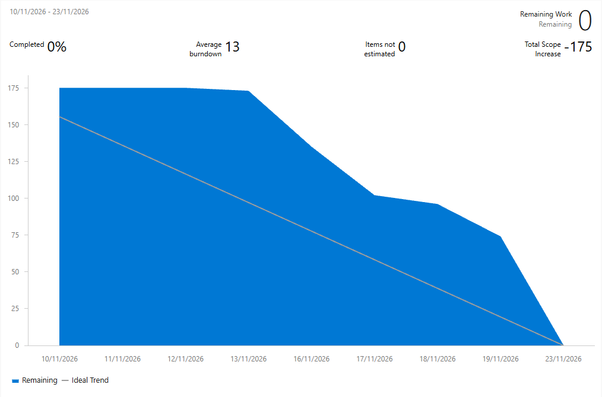</p>

### Sprint 4

- **Período previsto:** de 24/11/2026 a 07/12/2026, data de encerramento da Release 2. As datas serão confirmadas no planejamento da Sprint 4.
- **Escopo previsto:** RF19 a RF22, além das pendências da Sprint 3 listadas acima.
- **Situação:** planejada. O planejamento, os papéis e os resultados da Sprint 4 serão registrados neste documento quando estiverem disponíveis.

## 10. Documentação complementar

### Planejamento e acompanhamento

- [Sprint 3 — Planejamento](./Sprint03/planejamento.md)
- [Plano de contingência da Release 2](./Plano_Contingencia_ClinicalStudyPB.docx)
- [Links úteis, incluindo o Plano de Trabalho](../release1/LINKS-UTEIS.md)

### Arquitetura, contratos e acesso

- [Contratos da API RF12–RF18](./Sprint03/contratos-api-rf12-rf18.md)
- [Matriz de acesso e identificação do participante RF12–RF18](./Sprint03/matriz-acesso-e-identificacao-participante-rf12-rf18.md)
- [Diagramas de arquitetura e sequência RF12–RF18](./Sprint03/diagramas-arquitetura-sequencia-rf12-rf18.md)
- [Arquitetura e integração (Release 1)](../release1/arquitetura-e-integracao.md)
- [Banco de dados, migrations e seed](../release1/sprint01/banco_de_dados/README-BD.md)
- [Usuários e controle de acesso](../release1/usuarios-e-controle-de-acesso.md)

### Testes e qualidade

- [Relatório de cobertura e qualidade — Sprint 3](./Sprint03/testes/relatorio-cobertura-testes-automatizados.md)
- [Checklist de testes funcionais RF12–RF18](./Sprint03/testes/checklist-rf12-rf18.md)
- [Plano de testes e massa de dados RF12–RF18](./Sprint03/testes/plano-testes-massa-dados-rf12-rf18.md)
- [Relatório de execução e rastreabilidade — Sprint 3](./Sprint03/testes/relatorio-execucao-testes-sprint-3.md)
- [Workflows de CI — backend, web e mobile](../../../.github/workflows/)

### Release 1 e projeto

- [README da Release 1](../release1/README.md)
- [README principal](../../../README.md)
- [README do backend](../../../backend/README.md)
- [README do mobile](../../../mobile/README.md)
