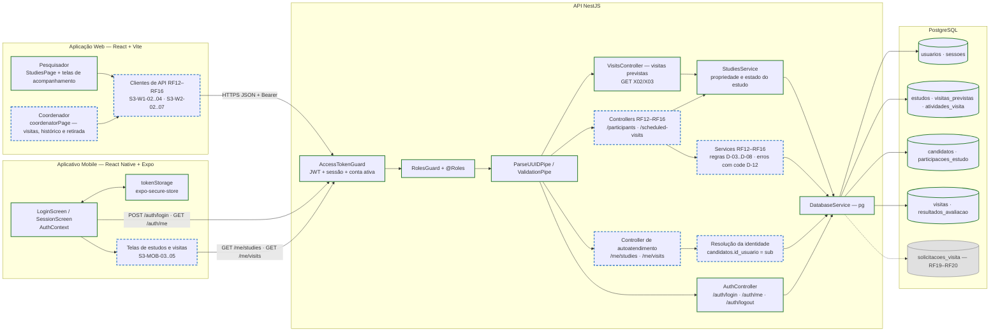
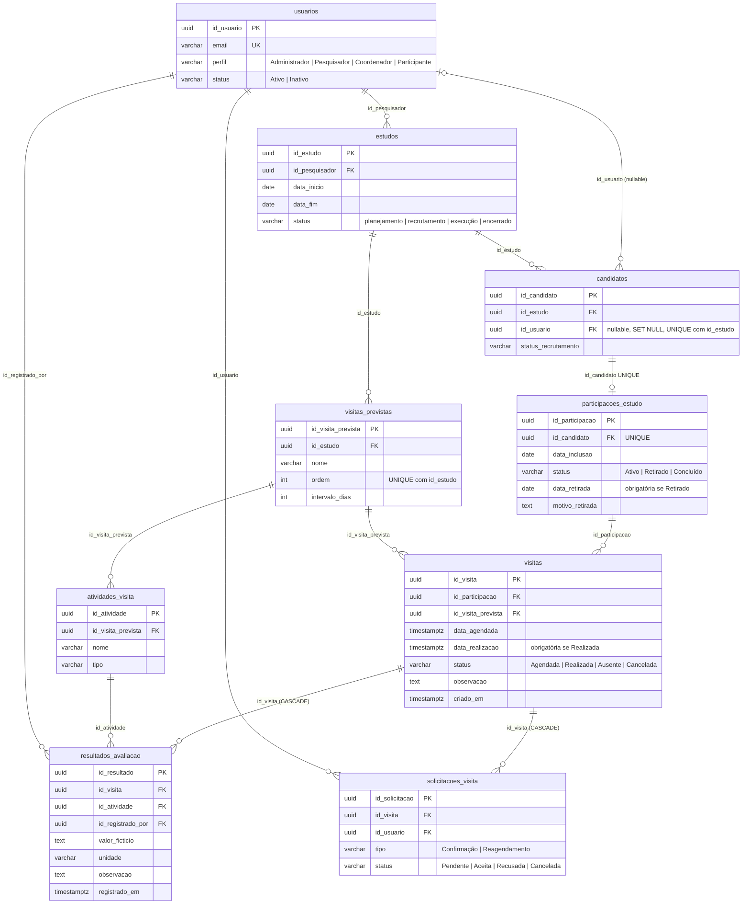
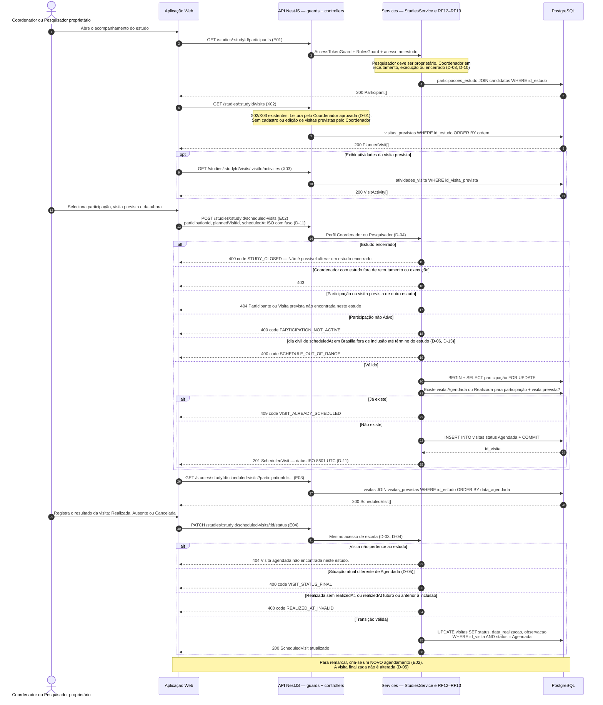
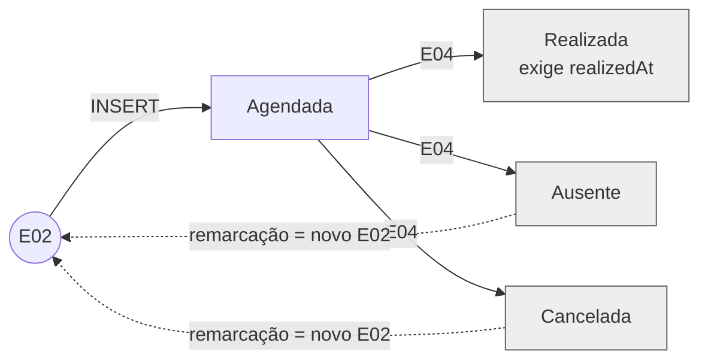
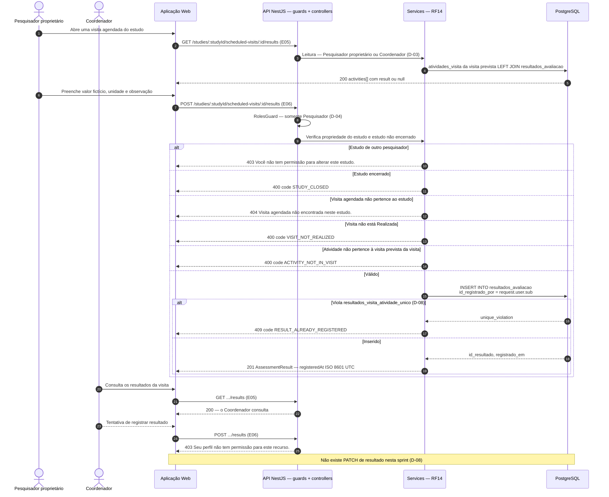
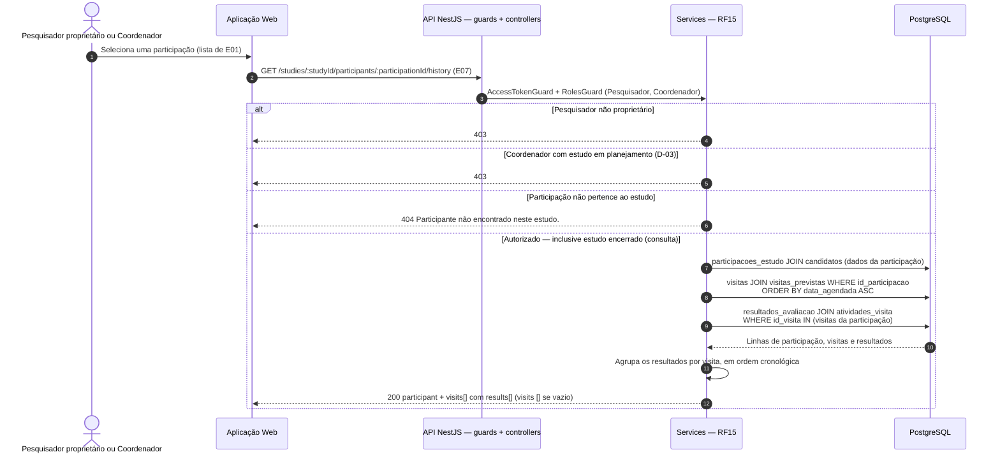
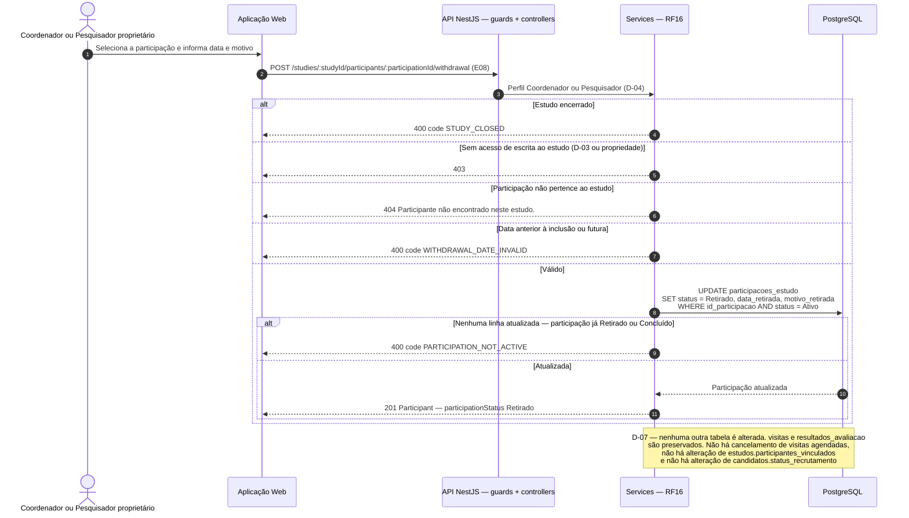
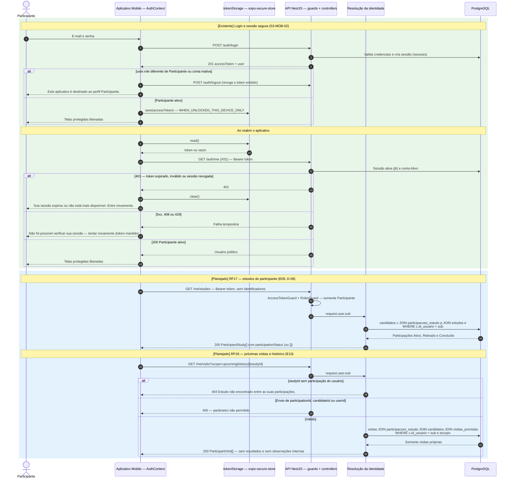

# Diagramas de arquitetura e sequência — RF12 a RF18

| Item | Valor |
|---|---|
| **Projeto** | ClinicalStudyPB — Sistema de Gestão de Estudos Clínicos |
| **Release / Sprint** | Release 2 — Sprint 3 (10/11/2026 a 23/11/2026) |
| **Task** | S3-PO-05 — Atualizar diagramas de arquitetura e sequência |
| **Responsável** | Zeton (Líder técnico / Gerente) |
| **Base** | S3-PO-03 [`contratos-api-rf12-rf18.md`](./contratos-api-rf12-rf18.md) · S3-PO-04 [`matriz-acesso-e-identificacao-participante-rf12-rf18.md`](./matriz-acesso-e-identificacao-participante-rf12-rf18.md) |
| **Código analisado** | Branch `feat/proposta-contrato-api-e-matriz-acesso`, commit `3649b91` (inclui o PR #27, autenticação Mobile) |
| **Versão** | 1.1 — 20/11/2026 |

### Legenda usada em todo o documento

| Marca | Significado |
|---|---|
| **[Existente]** | Componente ou comportamento confirmado no código do commit analisado. |
| **[Planejado]** | Aprovado para implementação na Sprint 3, ainda não implementado. |
| **[Adiado]** | Fora do escopo da Sprint 3 (Plano de Contingência ou Sprint 4). |
| **D-xx** | Decisão técnica aprovada (seção 5). |

Nos diagramas `flowchart`: borda contínua indica existente, borda tracejada indica planejado e fundo cinza indica adiado.

---

## Sumário

1. [Identificação](#1-identificação)
2. [Objetivo](#2-objetivo)
3. [Referências](#3-referências)
4. [Estado atual da arquitetura](#4-estado-atual-da-arquitetura)
5. [Decisões técnicas aprovadas — D-01 a D-13](#5-decisões-técnicas-aprovadas--d-01-a-d-13)
6. [Diagrama geral de arquitetura](#6-diagrama-geral-de-arquitetura)
7. [Diagrama do modelo persistente](#7-diagrama-do-modelo-persistente)
8. [Sequência RF12–RF13 — agendamento e situação das visitas](#8-sequência-rf12rf13--agendamento-e-situação-das-visitas)
9. [Sequência RF14 — registro de resultados](#9-sequência-rf14--registro-de-resultados)
10. [Sequência RF15 — histórico do participante](#10-sequência-rf15--histórico-do-participante)
11. [Sequência RF16 — retirada do participante](#11-sequência-rf16--retirada-do-participante)
12. [Sequência RF17–RF18 — identificação e acompanhamento pelo Mobile](#12-sequência-rf17rf18--identificação-e-acompanhamento-pelo-mobile)
13. [Fluxos alternativos e respostas de erro](#13-fluxos-alternativos-e-respostas-de-erro)
14. [Alterações estruturais necessárias](#14-alterações-estruturais-necessárias)
15. [Limitações e observações](#15-limitações-e-observações)
16. [Histórico de versões](#16-histórico-de-versões)

---

## 1. Identificação

Este documento é a entrega da S3-PO-05. Ele representa visualmente a comunicação entre Web, Mobile, API NestJS e PostgreSQL nos fluxos de RF12–RF18, de acordo com:

- os contratos da S3-PO-03 (endpoints X01–X03 e E01–E10);
- a matriz de acesso e o fluxo de identificação da S3-PO-04;
- as decisões D-01 a D-13, **aprovadas pela equipe** após a S3-PO-04.

## 2. Objetivo

Servir como referência arquitetural única para a implementação e a integração da Sprint 3, deixando explícito:

- o que já existe no código e o que ainda será implementado;
- por quais camadas cada requisição passa e em que ordem as verificações ocorrem;
- quais tabelas existentes cada fluxo lê ou grava, sem novas estruturas.

## 3. Referências

| Fonte | Uso |
|---|---|
| Especificação *ProjetoES2-2026.2* | RF12–RF18, perfis e interfaces. |
| *Plano de Trabalho*, backlog da Sprint 3 | Descrição de S3-PO-05 e das tasks S3-BE, S3-W1, S3-W2, S3-MOB e S3-QA. |
| S3-PO-03 — `contratos-api-rf12-rf18.md` | Rotas, corpos, respostas, códigos de erro e decisões D-01 a D-13 (seção 13). |
| S3-PO-04 — `matriz-acesso-e-identificacao-participante-rf12-rf18.md` | Perfis, condições P1–P3, C1–C2 e T1–T2, fluxo de identificação e limitações L-01 a L-06. |
| `docs/releases/release2/Plano_Contingencia_ClinicalStudyPB.docx` | Contingências adiadas (consulta, sem alteração). |
| `docs/releases/release1/README.md`, seção 2.1 | Padrão dos diagramas da Release 1 (atores “Aplicação Web”, “API NestJS” e “PostgreSQL”). |
| `backend/migrations/001`–`016` | Tabelas, chaves e constraints. |
| `backend/src/auth`, `backend/src/studies` | Guards, decorators, controllers e services existentes. |
| `mobile/src/auth`, `mobile/src/app/_layout.tsx` | Autenticação Mobile implementada pela S3-MOB-02. |

## 4. Estado atual da arquitetura

### 4.1 Backend [Existente]

| Camada | Componentes no código |
|---|---|
| Entrada HTTP | NestJS (`main.ts`), CORS para a Web e Swagger em `/api`. |
| Autenticação | `AccessTokenGuard`: JWT HS256 (`token.util.ts`), sessão ativa em `sessoes` (`SessionsService`) e conta `Ativo`, com o perfil relido do banco. |
| Autorização | `@Roles(...)` + `RolesGuard` (403 por perfil). |
| Validação | `ParseUUIDPipe` em parâmetros; `ValidationPipe` com DTOs de `swagger/api.models.ts`. |
| Controllers | `AuthController`, `UsersController`, `StudiesController`, `CriteriaController`, `VisitsController` (visitas **previstas**, RF06) e `CandidatesController`. |
| Services | `StudiesService` (inclui `assertStudyCanBeModified`, `assertCandidateStudyAccess` e `assertInclusionStudyAccess`), `VisitsService`, `CandidatesService`, `CriteriaService`, `UsersService` e `AuthService`. |
| Persistência | `DatabaseService` (driver `pg`, SQL explícito, `transaction()`), sem ORM. |
| RF12–RF18 | **Nenhum endpoint implementado.** As tabelas `visitas`, `resultados_avaliacao` e `solicitacoes_visita` não são usadas por nenhum service. `participacoes_estudo` só é gravada pela inclusão (RF11). |

### 4.2 Web [Existente]

| Item | Situação |
|---|---|
| Pesquisador | `StudiesPage` (estudos, critérios, visitas previstas e estado do estudo) integrada à API. |
| Coordenador | `coordenatorPage.tsx`: o recrutamento (RF08–RF11) está integrado à API. **Visitas, painel e reagendamentos usam dados fixos** em `useState`; a substituição está prevista em S3-W2-02 a S3-W2-07. |
| Participante | Recusado na Web. |

### 4.3 Mobile

| Item | Situação |
|---|---|
| Login e logout (`POST /auth/login`, `POST /auth/logout`) | [Existente] |
| **S3-MOB-02 — restauração segura da sessão** | **[Existente]** (PR #27): `tokenStorage.ts` grava o token com `expo-secure-store` (`WHEN_UNLOCKED_THIS_DEVICE_ONLY`). Ao abrir, o `AuthContext.restore()` chama `GET /auth/me`. Um **401** limpa a sessão local. **5xx, 408 ou 429** mantêm o token e oferecem nova tentativa (`SessionScreen`). Perfil diferente de Participante ou conta inativa fazem o app limpar a sessão local e revogar o token no servidor. As rotas protegidas (`Stack.Protected`) exigem `role = Participante` e `status = Ativo`. |
| Estudos e visitas do participante (RF17–RF18) | [Planejado] S3-MOB-03 a S3-MOB-05. Ainda não existe cliente HTTP para `/me/*`. A tela inicial mostra apenas os dados da conta. |

## 5. Decisões técnicas aprovadas — D-01 a D-13

A equipe **aprovou** as recomendações D-01 a D-12 da seção 13 da S3-PO-03. As marcações “pendente” dessas decisões na S3-PO-03 e na S3-PO-04 estão **superadas** por essa aprovação; D-13 foi aprovada e registrada nesta versão. A aprovação vale para a regra, mas a implementação continua **[Planejado]**.

| Decisão | Regra aprovada |
|---|---|
| D-01 | O Coordenador recebe **somente leitura** de X02 (`GET /studies/:studyId/visits`) e X03 (`GET /studies/:studyId/visits/:visitId/activities`) nos estados de A-EQUIPE-LEITURA, como parte de S3-BE-02/S3-W2-02. Não cadastra, não edita e não remove visitas previstas. |
| D-02 | As visitas agendadas usam `/studies/:studyId/scheduled-visits`. |
| D-03 | O Coordenador consulta em `recrutamento`, `execução` e `encerrado`, e escreve em `recrutamento` e `execução`. Escrita em estudo encerrado resulta em 400 “Não é possível alterar um estudo encerrado.” |
| D-04 | RF12, RF13 e RF16: Coordenador e Pesquisador proprietário. RF14: somente Pesquisador proprietário. RF15: ambos. RF17–RF18: Participante. |
| D-05 | `Agendada → Realizada \| Ausente \| Cancelada`. Os estados finais são imutáveis, e remarcar exige um novo agendamento. |
| D-06 | `scheduledAt` pode estar no passado, desde que esteja entre a inclusão do participante e o término do estudo. |
| D-07 | A retirada atualiza somente o status, a data e o motivo da participação. Não cancela visitas, não altera o contador de vagas e não muda o status de recrutamento. O histórico é preservado. |
| D-08 | Não existe correção de resultado. Um registro duplicado resulta em **409**. |
| D-09 | E09 lista participações `Ativo`, `Retirado` e `Concluído`, com `participationStatus`. |
| D-10 | Não existe vínculo Coordenador–estudo. O Coordenador acessa todos os estudos nos estados permitidos. |
| D-11 | As novas respostas usam ISO 8601 em UTC (`2026-11-20T12:00:00.000Z`) e as requisições, ISO 8601 com fuso. Os endpoints existentes mantêm o formato atual. |
| D-12 | As recusas de domínio de RF12–RF16 incluem o campo `code` (por exemplo, `VISIT_ALREADY_SCHEDULED`), que é distinto do `statusCode` HTTP. |
| D-13 | `America/Sao_Paulo` é o fuso oficial para regras de negócio que dependem de datas civis. Em E02, o dia de `scheduledAt` nesse fuso é comparado inclusivamente a `data_inclusao` e `data_fim`; em E03, `from` e `to` filtram inclusivamente por esse dia civil. Instantes continuam armazenados e retornados em UTC (D-11). |

**Itens não abrangidos por esta aprovação:**

- As contingências do Plano continuam **[Adiado]** (seção 15.3).
- A pendência **P-01** da S3-PO-03, que corresponde à L-01 da S3-PO-04 (preenchimento de `candidatos.id_usuario`), **continua em aberto** (seção 15.1).
- Os pontos A-01 e A-02 da S3-PO-04 foram representados conforme a orientação desta task: o Participante não acessa resultados, e o Coordenador consulta resultados sem registrá-los.

## 6. Diagrama geral de arquitetura



**Leitura do diagrama:**

- **[Existente]**:
  - autenticação, guards e pipes;
  - `AuthController` e `VisitsController` (com leitura restrita ao Pesquisador; a ampliação ao Coordenador é **[Planejado]**, D-01);
  - `StudiesService` e `DatabaseService`;
  - todas as tabelas;
  - login e sessão segura no Mobile.
- **[Planejado]**:
  - controllers e services de RF12–RF16;
  - controller `/me` e resolução da identidade;
  - telas Web de acompanhamento com dados da API;
  - telas Mobile de estudos e visitas.

  Os nomes dos controllers planejados são indicativos e serão definidos em S3-BE-02 a S3-BE-07.
- `T4` existe no schema, mas só será lido e gravado pelos services planejados.
- `solicitacoes_visita` existe no schema e não é usada na Sprint 3 (ligação tracejada).

## 7. Diagrama do modelo persistente

Tabelas reais (migrations 001, 003, 006–008, 011–014 e 016), sem tabelas ou colunas novas. Por legibilidade, são mostrados apenas os campos relevantes para RF12–RF18.



### 7.1 Visitas previstas × visitas agendadas

| Tabela | Significado | Quem grava | Endpoints |
|---|---|---|---|
| `visitas_previstas` + `atividades_visita` | **Protocolo** do estudo: quais visitas e atividades existem (RF06). | Pesquisador proprietário [Existente] | X02, X03 (leitura; o Coordenador lê por D-01) |
| `visitas` | **Agenda real** de cada participante: uma ocorrência de uma visita prevista para uma participação (RF12–RF13). | Coordenador / Pesquisador proprietário [Planejado] | E02, E03, E04, E10 |
| `resultados_avaliacao` | Resultado de **uma atividade prevista** dentro de **uma visita agendada** (RF14). | Pesquisador proprietário [Planejado] | E05, E06, E07 |

### 7.2 Constraints relevantes para os fluxos [Existente]

| Constraint / regra do schema | Efeito nos fluxos |
|---|---|
| `participacoes_retirada_coerente` | `Retirado` exige `data_retirada`; os demais estados exigem que ela seja nula (E08). |
| `participacoes_datas_validas` | `data_retirada >= data_inclusao` (E08). |
| `visitas_realizacao_coerente` | `Realizada` exige `data_realizacao` (E04). |
| `resultados_visita_atividade_unico` | Um resultado por visita e atividade. Um segundo registro resulta em 409 (E06, D-08). |
| `candidatos_estudo_usuario_unico` | Uma conta tem no máximo um candidato por estudo (E09/E10). |
| `participacoes_estudo.id_candidato UNIQUE` | No máximo uma participação por candidato. |
| **Ausente no schema** | Unicidade de participação + visita prevista em `visitas`. A verificação de duplicidade de E02 fica no service, com bloqueio em transação. |
| **Ausente no schema** | Garantia de que `visitas.id_visita_prevista` e `visitas.id_participacao` pertencem ao **mesmo estudo**. O service de E02 valida os dois vínculos. |

## 8. Sequência RF12–RF13 — agendamento e situação das visitas

Regras aplicadas: **D-01, D-02, D-03, D-04, D-05, D-06, D-11, D-12**. Todos os endpoints de RF12–RF13 estão **[Planejado]**. X02 e X03 existem, e a leitura pelo Coordenador é **[Planejado]** (D-01).



### 8.1 Transições da situação da visita (D-05)



`Realizada`, `Ausente` e `Cancelada` são finais. Uma nova tentativa de E04 sobre elas resulta em 400 `VISIT_STATUS_FINAL`. Depois de `Realizada`, o mesmo par participação + visita prevista não pode ser agendado de novo (409).

## 9. Sequência RF14 — registro de resultados

Regras aplicadas: **D-04** (somente o Pesquisador proprietário registra), **D-08**, **D-11** e **D-12**. E05 e E06 estão **[Planejado]**.



## 10. Sequência RF15 — histórico do participante

Regras aplicadas: **D-03**, **D-04** e **D-11**. E07 está **[Planejado]**.



## 11. Sequência RF16 — retirada do participante

Regras aplicadas: **D-03**, **D-04**, **D-07**, **D-11** e **D-12**. E08 está **[Planejado]**.



## 12. Sequência RF17–RF18 — identificação e acompanhamento pelo Mobile

Regras aplicadas: **D-09**, **D-11** e a identificação da S3-PO-04 (seção 9).

- **[Existente]:** login, `tokenStorage`, restauração com `GET /auth/me` e as guardas de rota (S3-MOB-02).
- **[Planejado]:** E09 e E10, no backend (S3-BE-07) e no app (S3-MOB-03 a S3-MOB-05).



**Observações do fluxo Mobile:**

- A identidade vem **exclusivamente** de `request.user.sub`. A condição `c.id_usuario = sub` faz parte do SQL e não é um filtro aplicado em memória.
- `upcoming` retorna visitas `Agendada` em ordem crescente; `history` retorna `Realizada`, `Ausente` e `Cancelada` em ordem decrescente.
- O Participante **não recebe** `resultados_avaliacao`, `visitas.observacao`, e-mail ou dados de terceiros.
- **Dependência L-01 / P-01:** como `candidatos.id_usuario` não é preenchido pelo cadastro atual, os passos de E09/E10 retornam `[]` para participantes reais até que o vínculo exista (seção 15.1).

## 13. Fluxos alternativos e respostas de erro

| Cenário | Endpoints | HTTP | `code` (D-12) | Origem |
|---|---|---|---|---|
| Token ausente | todos | 401 | — | `AccessTokenGuard` [Existente] |
| Token inválido, expirado ou sessão revogada | todos | 401 | — | `AccessTokenGuard` [Existente] |
| Conta inativa | todos | 401 | — | `AccessTokenGuard` [Existente] |
| Perfil sem permissão (ex.: Participante em `/studies`, Coordenador em E06, equipe em `/me`) | todos | 403 | — | `RolesGuard` [Existente] |
| Pesquisador não proprietário | E01–E08 | 403 | — | Service (padrão de `StudiesService`) |
| Coordenador fora dos estados de D-03 | E01–E08, X02, X03 | 403 | — | Service [Planejado] |
| Estudo encerrado em escrita | E02, E04, E06, E08 | 400 | `STUDY_CLOSED` | Service [Planejado] |
| Estudo inexistente | E01–E08, X02, X03 | 404 | — | Service |
| Recurso de outro estudo (participação, visita, visita prevista) | E02–E08 | 404 | — | Service [Planejado] |
| Participação inexistente | E02, E07, E08 | 404 | — | Service [Planejado] |
| Participação retirada ou concluída | E02, E04, E08 | 400 | `PARTICIPATION_NOT_ACTIVE` | Service [Planejado] |
| Data de agendamento fora do período | E02 | 400 | `SCHEDULE_OUT_OF_RANGE` | D-06 |
| Agendamento duplicado | E02 | 409 | `VISIT_ALREADY_SCHEDULED` | Service + lock |
| Transição inválida | E04 | 400 | `VISIT_STATUS_FINAL` | D-05 |
| Data de realização inválida | E04 | 400 | `REALIZED_AT_INVALID` | Service |
| Resultado em visita não realizada | E06 | 400 | `VISIT_NOT_REALIZED` | Service |
| Atividade fora da visita prevista | E06 | 400 | `ACTIVITY_NOT_IN_VISIT` | Service |
| Resultado duplicado | E06 | 409 | `RESULT_ALREADY_REGISTERED` | `resultados_visita_atividade_unico` (D-08) |
| Data de retirada inválida | E08 | 400 | `WITHDRAWAL_DATE_INVALID` | `participacoes_datas_validas` + service |
| Participante sem vínculo de candidato | E09, E10 | 200 `[]` | — | S3-PO-04 |
| `studyId` sem participação do usuário | E10 | 404 | — | S3-PO-04 |
| Identificador de pessoa enviado em `/me` | E09, E10 | 400 | — | `ValidationPipe` (`forbidNonWhitelisted`) |
| Corpo ou UUID inválido | todos | 400 | — | `ParseUUIDPipe` / `ValidationPipe` [Existente] |
| Falha de persistência ou erro inesperado | todos | 500 | — | NestJS. A transação é desfeita e o cliente exibe mensagem genérica. No Mobile, o token é mantido e a ação pode ser repetida |

Formato de erro (padrão NestJS + `code` de D-12):

```json
{ "statusCode": 409, "message": "Esta visita prevista já está agendada ou realizada para o participante.", "error": "Conflict", "code": "VISIT_ALREADY_SCHEDULED" }
```

## 14. Alterações estruturais necessárias

**Nenhuma alteração estrutural no modelo persistente foi identificada como necessária para representar os fluxos de RF12–RF18. Os contratos deverão reutilizar as estruturas existentes.**

Fundamentação:

- `visitas` já contém participação, visita prevista, data agendada, data de realização, situação e observação (RF12–RF13).
- `resultados_avaliacao` já contém valor fictício, unidade, observação, autor e unicidade por visita e atividade (RF14, D-08).
- `participacoes_estudo` já contém status `Retirado`, `data_retirada` e `motivo_retirada`, com constraints de coerência (RF16, D-07).
- `candidatos.id_usuario` já permite a identificação do participante (RF17–RF18).
- As duas regras sem constraint no banco — duplicidade de agendamento e mesmo estudo entre participação e visita prevista — são garantidas no service, em transação, sem necessidade de migration.

## 15. Limitações e observações

### 15.1 Vínculo conta–participante (continua aberto)

| Aspecto | Situação |
|---|---|
| Coluna `candidatos.id_usuario` | Existe no schema. |
| Preenchimento | **Nenhum código, seed ou teste o preenche.** O cadastro de candidatos grava apenas o estudo, o nome e o e-mail. |
| Efeito | Os diagramas da seção 12 estão corretos e seguros, mas E09/E10 retornam `[]` para participantes reais. |
| O que **não** fazer | Associar por nome ou e-mail, ou aceitar identificador do Mobile. |
| Encaminhamento | A correção completa (S3C-PBI01) está **[Adiado]** para a Sprint 4. A decisão sobre usar fixtures e seed com o vínculo para testes e demonstração na Sprint 3 continua pendente (P-01). |

### 15.2 Outras observações

- Não existe vínculo Coordenador–estudo (D-10). O diagrama não representa tabela de relacionamento.
- `solicitacoes_visita` aparece apenas como estrutura existente para RF19–RF20 (Sprint 4). Nenhum fluxo desta sprint a lê ou grava.
- A tabela `auditoria` existe, mas não participa dos fluxos (auditoria adiada).
- Na Web, a sessão e o tratamento de 401 seguem o `AuthContext` existente. As telas do Coordenador com dados fixos serão substituídas por E01–E08 (S3-W2-07).

### 15.3 Contingências mantidas como [Adiado]

| Proposta | Situação |
|---|---|
| Consulta de contas Participante pelo Coordenador e vínculo no cadastro (S3C-BE-01, S3C-BE-02, S3C-W2-01, S3C-W1-01) | Adiado |
| Edição de visitas previstas e atividades (S3C-BE-04, S3C-W1-03) | Adiado. D-01 aprova **somente leitura**. |
| Termo de consentimento do participante (S3C-PBI04) | Adiado |
| Auditoria das operações (S3C-BE-06) | Adiado |
| Dados demonstrativos (**S3C-MOB-02**) | Adiado. Diferente de **S3-MOB-02**, já implementada. |

## 16. Histórico de versões

| Versão | Data | Autor | Descrição |
|---|---|---|---|
| 1.0 | 16/11/2026 | Zeton (S3-PO-05) | Diagramas de arquitetura (flowchart), modelo persistente (erDiagram), transições de visita e sequências de RF12–RF18 com as decisões D-01 a D-12 aprovadas, a S3-MOB-02 implementada (PR #27) e as limitações em aberto. |
| 1.1 | 20/11/2026 | Equipe | Registrada D-13: `America/Sao_Paulo` como referência para comparações por dia civil em E02 e E03; instantes continuam persistidos e retornados em UTC conforme D-11. |
