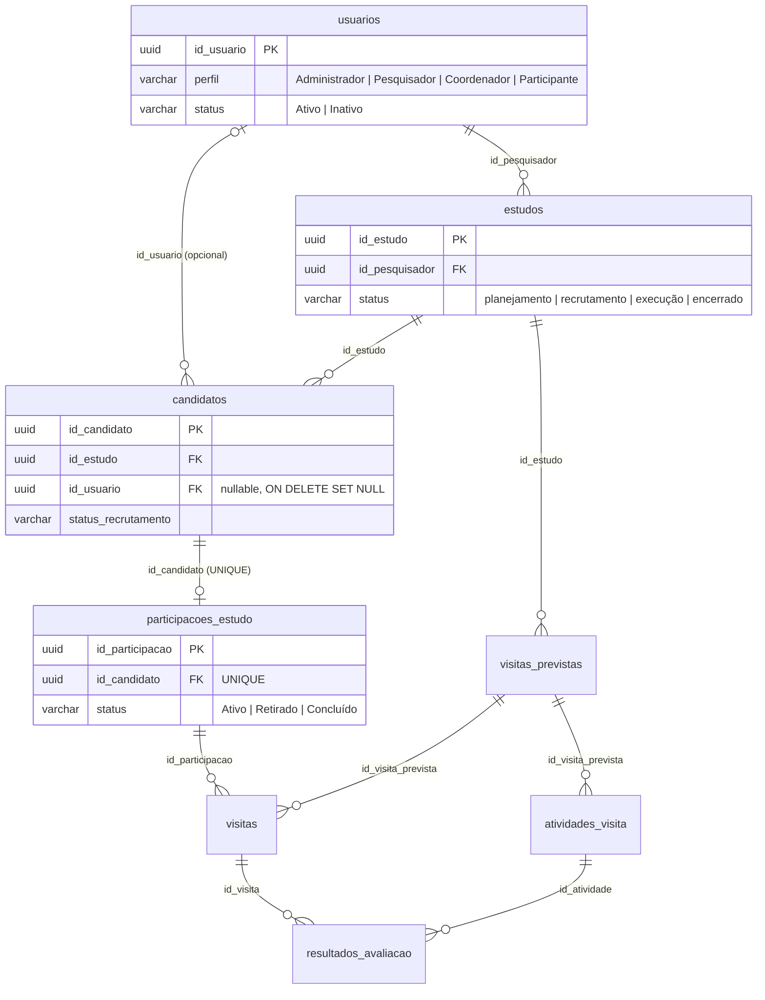
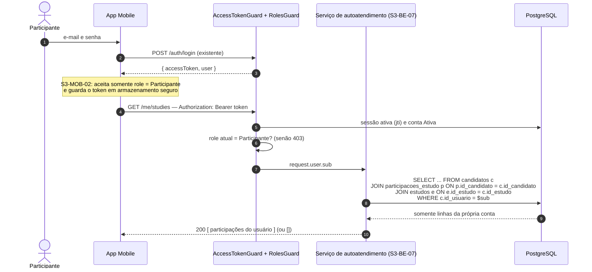
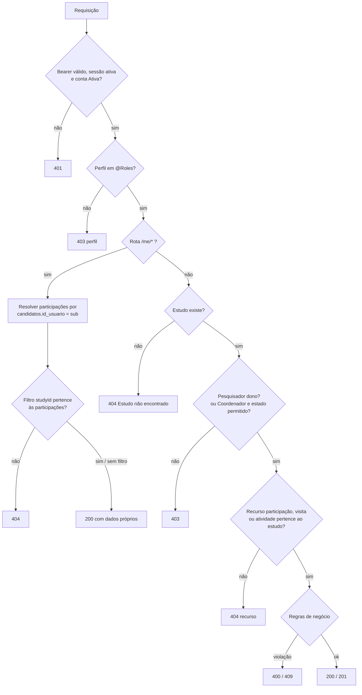

# Matriz de acesso e identificação do participante — RF12 a RF18

| Item | Valor |
|---|---|
| **Projeto** | ClinicalStudyPB — Sistema de Gestão de Estudos Clínicos |
| **Release / Sprint** | Release 2 — Sprint 3 (10/11/2026 a 23/11/2026) |
| **Task** | S3-PO-04 — Definir matriz de acesso e fluxo de identificação do participante |
| **Responsável** | Zeton (Líder técnico / Gerente) |
| **Depende de** | S3-PO-03 — [`contratos-api-rf12-rf18.md`](./contratos-api-rf12-rf18.md) |
| **Versão** | 0.1 — proposta para validação da equipe (15/11/2026) |

> **Como ler este documento.** As regras estão marcadas por origem:
> **[Especificação]** — definida no documento oficial do projeto;
> **[Código]** — comportamento existente verificado no repositório;
> **[Contrato]** — definida na S3-PO-03 como proposta, ainda pendente de validação;
> **[Pendente]** — depende de decisão da equipe (seção 15);
> **[Adiado]** — proposta do Plano de Contingência fora do escopo da Sprint 3.

---

## Sumário

1. [Identificação](#1-identificação)
2. [Objetivo](#2-objetivo)
3. [Referências](#3-referências)
4. [Contexto técnico e premissas](#4-contexto-técnico-e-premissas)
5. [Perfis de usuário](#5-perfis-de-usuário)
6. [Matriz de acesso por funcionalidade e operação](#6-matriz-de-acesso-por-funcionalidade-e-operação)
7. [Regras de autorização por perfil](#7-regras-de-autorização-por-perfil)
8. [Relacionamento entre usuários, candidatos e estudos](#8-relacionamento-entre-usuários-candidatos-e-estudos)
9. [Fluxo de identificação do participante autenticado](#9-fluxo-de-identificação-do-participante-autenticado)
10. [Fluxo de segurança e autorização no Backend](#10-fluxo-de-segurança-e-autorização-no-backend)
11. [Relação RF → endpoint → perfil → condição](#11-relação-rf--endpoint--perfil--condição)
12. [Cenários de erro e restrições de acesso](#12-cenários-de-erro-e-restrições-de-acesso)
13. [Dependências técnicas e limitações](#13-dependências-técnicas-e-limitações)
14. [Contingências adiadas (fora do escopo)](#14-contingências-adiadas-fora-do-escopo)
15. [Pendências e decisões para validação](#15-pendências-e-decisões-para-validação)
16. [Histórico](#16-histórico)

---

## 1. Identificação

Este documento complementa a S3-PO-03. A S3-PO-03 definiu **rotas e formatos** de RF12–RF18; este define **quem pode usar cada rota, sob quais vínculos**, e **como o Backend identifica o participante** nas consultas do Mobile. Não altera nenhuma rota, campo ou código de erro da S3-PO-03.

## 2. Objetivo

Estabelecer uma referência única para Backend, Web e Mobile sobre:

1. Quais perfis consultam e quais operam visitas, resultados, histórico e retirada.
2. Quais condições de vínculo (estudo próprio, estado do estudo, participação própria) se aplicam a cada operação.
3. Como o Backend identifica o participante a partir do token, sem aceitar identidade informada pelo cliente.
4. Como as respostas 401, 403 e 404 se distribuem entre autenticação, autorização e vínculo.

## 3. Referências

| Fonte | Uso neste documento |
|---|---|
| Especificação *ProjetoES2-2026.2* (seções 2 e 3 e figura de perfis) | Responsabilidades de cada perfil e interface (Web/Mobile) de RF12–RF18. |
| *Plano de Trabalho*, backlog da Sprint 3 | Descrições de S3-PO-04, S3-BE-02 a S3-BE-07, S3-W1-05, S3-MOB-02 a S3-MOB-05 e S3-QA-03/05. |
| [`contratos-api-rf12-rf18.md`](./contratos-api-rf12-rf18.md) (S3-PO-03) | Endpoints X01–X03 e E01–E10, regras A-EQUIPE-*, A-PARTICIPANTE e decisões D-01 a D-12. |
| `docs/releases/release2/Plano_Contingencia_ClinicalStudyPB_Sprint3.docx` | Problemas P06 e P07 (acesso às visitas previstas e vínculo conta–candidato). Consultado sem alteração. |
| `docs/releases/release1/usuarios-e-controle-de-acesso.md` | Perfis e regras de acesso da Release 1. |
| `backend/src/auth/*` | `AccessTokenGuard`, `RolesGuard`, `@Roles`, `token.util.ts`, `SessionsService`. |
| `backend/src/studies/studies.service.ts` | `assertCandidateStudyAccess`, `assertInclusionStudyAccess`, `assertStudyCanBeModified`, `findById`. |
| `backend/migrations/001, 003, 008, 011, 012, 013` | `usuarios`, `estudos`, `candidatos`, `participacoes_estudo`, `visitas` e `resultados_avaliacao`. |
| `mobile/src/auth/AuthContext.tsx` e `web/src/auth/AuthContext.tsx` | Perfis aceitos por cada cliente. |

## 4. Contexto técnico e premissas

### 4.1 Decisões da Weekly Meeting (S3-PO-02)

- Foco nas entregas originais de RF12–RF18.
- Contingências do Plano adiadas para a Sprint 4 (seção 14).
- **S3-MOB-02** — autenticação Mobile com restauração segura da sessão — faz parte do planejamento atual. Não confundir com a proposta adiada **S3C-MOB-02** (dados demonstrativos).

### 4.2 Mecanismos existentes [Código]

| Mecanismo | Comportamento verificado |
|---|---|
| Token | JWT HS256 com `sub` (id do usuário), `role`, `jti`, `iat` e `exp`, válido por 1 hora (`token.util.ts`). |
| `AccessTokenGuard` | Exige `Authorization: Bearer`, valida a assinatura e a validade, confere a sessão ativa em `sessoes` e relê a conta no banco. Conta inativa resulta em 401. **O perfil usado na requisição é o perfil atual do banco**, não o do token. |
| `RolesGuard` + `@Roles(...)` | Recusa com 403 “Seu perfil não tem permissão para este recurso.” quando o perfil não está na lista. |
| Vínculo de estudo | Pesquisador: `estudos.id_pesquisador = sub` (`findById`, `assertStudyCanBeModified`). Coordenador: **sem vínculo com estudo no schema**; o acesso é condicionado só ao estado do estudo (`assertCandidateStudyAccess`, hoje `recrutamento`). |
| Web | Aceita somente Administrador, Pesquisador e Coordenador; o Participante é recusado. |
| Mobile | Hoje aceita os quatro perfis e mantém a sessão em memória. A S3-MOB-02 restringe o acesso ao Participante e persiste o token com segurança. |

### 4.3 Premissas

- Nenhuma nova tabela, coluna ou mecanismo de autenticação é necessário para as regras deste documento.
- A autorização é **sempre** aplicada no Backend. As restrições de menu e rota da Web e do Mobile são complementares e não substituem as verificações da API.

## 5. Perfis de usuário

| Perfil | Interface | Responsabilidades em RF12–RF18 [Especificação] | Observação |
|---|---|---|---|
| **Administrador** | Web | Nenhuma. Gerencia usuários, perfis, configurações e auditoria (RF01). | Não opera estudos nem participantes. |
| **Pesquisador** | Web | RF12–RF16 conforme permissões da matriz. | Atua somente nos **estudos próprios**. D-04 aprova RF12, RF13 e RF16 para o Pesquisador proprietário e mantém RF14 exclusivo desse perfil. |
| **Coordenador** | Web | RF12–RF13 (agendar; registrar realização, ausência ou cancelamento), RF15 (histórico) e RF16 (processar retirada). | Sem vínculo formal com estudos. Acesso condicionado ao estado do estudo (D-03, D-10). |
| **Participante** | Mobile | RF17 (consultar estudos e participação) e RF18 (próximas visitas e histórico de comparecimento). | Somente os próprios dados. As solicitações (RF19–RF20) são da Sprint 4. |

## 6. Matriz de acesso por funcionalidade e operação

**Legenda:** ✅ Permitido · 🟡 Permitido com restrições · ⛔ Negado · — Não aplicável · ⏳ Pendente de decisão.
As condições de cada célula 🟡 estão nas notas abaixo da tabela e na seção 7.

| Funcionalidade | Operação | Endpoint | Administrador | Pesquisador | Coordenador | Participante |
|---|---|---|---|---|---|---|
| Participantes | Listar participantes incluídos no estudo | E01 | ⛔ | 🟡 (P1) | 🟡 (C1) | ⛔ |
| Visitas | Consultar visitas previstas e atividades para agendar | X02, X03 | ⛔ | 🟡 (P1) [Código] | ⏳ (D-01) — hoje ⛔ | ⛔ |
| Visitas | Agendar visita | E02 | ⛔ | 🟡 (P2) | 🟡 (C2) | ⛔ |
| Visitas | Consultar visitas agendadas do estudo | E03 | ⛔ | 🟡 (P1) | 🟡 (C1) | ⛔ |
| Visitas | Atualizar situação (Realizada / Ausente / Cancelada) | E04 | ⛔ | 🟡 (P2) | 🟡 (C2) | ⛔ |
| Visitas | Consultar as próprias visitas (próximas e histórico) | E10 | ⛔ | ⛔ | ⛔ | 🟡 (T1) |
| Resultados | Consultar atividades e resultados de uma visita | E05 | ⛔ | 🟡 (P1) | 🟡 (C1) | ⛔ |
| Resultados | Registrar resultado fictício | E06 | ⛔ | 🟡 (P3) | ⛔ | ⛔ |
| Resultados | Alterar resultado registrado | — | — | — | — | — |
| Histórico | Consultar histórico de um participante (visitas + resultados) | E07 | ⛔ | 🟡 (P1) | 🟡 (C1) | ⛔ |
| Histórico | Consultar o próprio histórico de comparecimento | E10 (`scope=history`) | ⛔ | ⛔ | ⛔ | 🟡 (T1) |
| Estudos do participante | Consultar estudos em que está incluído | E09 | ⛔ | ⛔ | ⛔ | 🟡 (T1) |
| Retirada | Consultar dados da retirada (data, motivo, situação) | E01, E07 | ⛔ | 🟡 (P1) | 🟡 (C1) | 🟡 (T2) |
| Retirada | Registrar retirada | E08 | ⛔ | 🟡 (P2) | 🟡 (C2) | ⛔ |

**Condições:**

| Código | Condição |
|---|---|
| **P1** | Pesquisador ativo **proprietário** do estudo (`estudos.id_pesquisador = sub`), em qualquer estado do estudo (consulta). |
| **P2** | P1 e estudo **não encerrado**. D-04 aprova essas operações para o Pesquisador proprietário, além do Coordenador nos estados de C2. |
| **P3** | P2 e visita agendada na situação `Realizada`, com a atividade pertencente à visita prevista dessa visita. |
| **C1** | Coordenador ativo; estudo em `recrutamento`, `execução` ou `encerrado` [Contrato, D-03]. |
| **C2** | Coordenador ativo; estudo em `recrutamento` ou `execução` [Contrato, D-03]. |
| **T1** | Participante ativo; somente registros de participações vinculadas à própria conta por `candidatos.id_usuario = sub` (seção 9). |
| **T2** | Somente a própria participação, via E09: `participationStatus` e `withdrawnAt`. O **motivo** da retirada não é exposto ao participante. |

**Notas da matriz:**

1. **Administrador negado em tudo** [Especificação + Código]: não há RF de acompanhamento atribuído a ele, e os controllers de estudo já não o incluem em `@Roles`.
2. **Participante sem nenhuma escrita** na Sprint 3: RF16 é operação Web da equipe. A retirada **voluntária** do participante é RF20 (Sprint 4), como solicitação, e não como registro direto.
3. **Resultados não são expostos ao Participante** [Contrato]: RF18 trata de visitas e comparecimento. Ver A-01 (seção 15).
4. **Alteração de resultado** não existe em nenhum contrato (D-08). A célula fica como não aplicável, e não como permissão.
5. A consulta de “dados da retirada” não tem endpoint próprio: os campos `withdrawnAt` e `withdrawalReason` fazem parte de `Participant` (E01, E07, E08).

## 7. Regras de autorização por perfil

### 7.1 Administrador

| Regra | Origem |
|---|---|
| Nenhuma rota de RF12–RF18 inclui `Administrador` em `@Roles`. Toda tentativa resulta em 403. | [Especificação] [Contrato] |
| Gestão de contas (RF01) permanece em `/users`, sem alteração. | [Código] |

### 7.2 Pesquisador

| Regra | Origem |
|---|---|
| Opera somente estudos próprios (`id_pesquisador`). Estudo de outro pesquisador resulta em 403 “Você não tem permissão para alterar este estudo.” (mesma verificação do código atual). | [Código] |
| Consulta participantes, visitas, resultados e histórico do estudo próprio em qualquer estado. | [Contrato] |
| Registra resultados fictícios (RF14) somente em estudo não encerrado e em visita `Realizada`. | [Especificação] [Contrato] |
| Agendar, atualizar situação e registrar retirada: permitido em estudo próprio não encerrado (D-04). | [Contrato, decisão aprovada] |

### 7.3 Coordenador

| Regra | Origem |
|---|---|
| Não existe vínculo Coordenador–estudo. O Coordenador acessa **qualquer** estudo nos estados permitidos, como já ocorre no recrutamento (RF08–RF11). | [Código] D-10 |
| Consulta: estudos em `recrutamento`, `execução` ou `encerrado`. | [Contrato] D-03 |
| Escrita (agendar, atualizar situação, retirada): estudos em `recrutamento` ou `execução`. | [Especificação] [Contrato] D-03 |
| **Não** registra resultados (RF14); D-04 mantém essa operação exclusiva do Pesquisador proprietário. | [Especificação] [Decisão aprovada] |
| **Não** lê visitas previstas (X02/X03) no código atual. A liberação é a pendência D-01 e **não está aprovada**. | [Código] [Pendente] |

### 7.4 Participante

| Regra | Origem |
|---|---|
| Usa somente `/me/studies` (E09) e `/me/visits` (E10). | [Contrato] |
| A identidade vem do token (`sub`), nunca de parâmetros (seção 9.3). | [Contrato] S3-BE-07 |
| Recebe 403 em todas as rotas `/studies/...` e `/users`. | [Código] `RolesGuard` |
| Não acessa a Web. | [Código] |
| Não realiza escritas na Sprint 3. | [Especificação] |

## 8. Relacionamento entre usuários, candidatos e estudos

### 8.1 Diagrama de entidades (schema real)



### 8.2 Cardinalidades verificadas nas migrations [Código]

| Relação | Cardinalidade | Evidência |
|---|---|---|
| `usuarios` → `candidatos` | 0..N candidatos por conta, **no máximo 1 por estudo** | `candidatos_estudo_usuario_unico UNIQUE (id_estudo, id_usuario)` e comentário da migration 008: “um usuário pode ser candidato em vários estudos, mas não duas vezes no mesmo”. |
| `candidatos` → `usuarios` | 0..1 conta por candidato | `id_usuario` **nullable**. Candidatos sem conta são permitidos. |
| `candidatos` → `estudos` | exatamente 1 estudo | `id_estudo NOT NULL`. |
| `candidatos` → `participacoes_estudo` | 0..1 participação | `participacoes_estudo.id_candidato UNIQUE`. |
| Conta excluída | Vínculo desfeito, histórico preservado | `ON DELETE SET NULL` em `candidatos.id_usuario`; as sessões são removidas em cascata. |

Consequência: uma conta Participante pode ter **várias participações, no máximo uma por estudo**. Uma lista de E09 pode, portanto, conter vários estudos, nunca o mesmo estudo duas vezes.

### 8.3 Existência, preenchimento e uso do vínculo

| Aspecto | Situação |
|---|---|
| **Existência no banco** | ✅ A coluna `candidatos.id_usuario` e a constraint existem (migration 008). |
| **Preenchimento efetivo** | ⛔ **Nenhum código preenche o campo.** `CandidatesService.create` grava somente `id_estudo`, `nome` e `email`. O seed (`backend/scripts/seed-demo.mjs`) não cria candidatos, e nenhum teste grava `id_usuario`. |
| **Uso nas consultas autenticadas** | Planejado em E09/E10 (S3-BE-07), conforme este documento. |

Limitação crítica: ver L-01 (seção 13).

## 9. Fluxo de identificação do participante autenticado

### 9.1 Sequência



Ao reabrir o app (S3-MOB-02), o Mobile chama `GET /auth/me` com o token salvo antes de liberar as telas. Um 401 descarta o token e leva ao login.

### 9.2 Passos no Backend [Contrato]

1. `AccessTokenGuard` valida o token, a sessão e a conta ativa, e preenche `request.user` com o `sub` e o perfil **atual**.
2. `RolesGuard` exige `Participante` (`@Roles('Participante')`).
3. O serviço obtém `userId = request.user.sub`. **Nenhum outro valor define a identidade.**
4. Resolve as participações do usuário:
   ```sql
   SELECT p.id_participacao, c.id_candidato, c.id_estudo
   FROM candidatos c
   JOIN participacoes_estudo p ON p.id_candidato = c.id_candidato
   WHERE c.id_usuario = $1;          -- $1 = request.user.sub
   ```
5. Toda consulta de E09/E10 inclui a condição `c.id_usuario = $1` **no próprio SQL** (join), e não como filtro aplicado em memória depois da consulta.
6. Filtros opcionais de recurso (somente `studyId` em E10) são combinados com essa condição. Sem linha correspondente, a resposta é 404 “Estudo não encontrado entre as suas participações.”
7. A resposta contém apenas os campos definidos nos contratos E09/E10 (sem e-mail, observações internas, resultados ou dados de terceiros).

**Proposta de implementação:** concentrar os passos 3–5 em um único método reutilizado pelos dois endpoints (por exemplo, `resolveOwnParticipations(userId)`). Assim a regra de identidade fica em um só lugar e é testada uma vez.

### 9.3 Identificadores proibidos e permitidos

| Parâmetro | Em `/me/*` | Motivo |
|---|---|---|
| `userId`, `participantId`, `candidateId`, `participationId` | **Proibidos.** O DTO de query usa `forbidNonWhitelisted`, então a requisição resulta em **400** em vez de ser ignorada. | Definiriam identidade. A identidade vem só do token. |
| `studyId` (E10) | Permitido como **filtro de recurso** | Validado contra as participações do próprio usuário (passo 6). |
| `scope` (E10) | Permitido | Não identifica ninguém. |

> **Identidade × recurso.** `sub` responde “quem está pedindo”. `studyId` responde “qual recorte dos meus dados”. Um recurso informado pelo cliente **nunca** amplia o conjunto de dados além das participações da própria conta.

### 9.4 O que **não** deve ser feito

- Não associar conta e candidato por **nome** ou **e-mail** (o e-mail do candidato é livre e pode divergir do e-mail da conta).
- Não aceitar identificador de participante enviado pelo Mobile.
- Não criar endpoint de “vincular minha conta” nesta sprint (fora do escopo e da especificação).

## 10. Fluxo de segurança e autorização no Backend

### 10.1 Conceitos

| Etapa | Pergunta | Mecanismo | Falha |
|---|---|---|---|
| **Autenticação** | Quem está pedindo? | `AccessTokenGuard` (token, sessão, conta ativa) | 401 |
| **Autorização por perfil** | Esse perfil pode fazer essa operação? | `@Roles` + `RolesGuard` | 403 |
| **Vínculo / propriedade** | Esse recurso pertence a um estudo ou participação a que o usuário tem acesso? | Serviço: dono do estudo, estado do estudo, `candidatos.id_usuario`, recurso pertencente ao estudo | 403 (estudo sem acesso) ou 404 (recurso fora do escopo) |
| **Regra de negócio** | A operação é válida agora? | Serviço: estudo encerrado, participação ativa, situação da visita, duplicidade | 400 / 409 |

### 10.2 Ordem de verificação



A validação dos parâmetros (`ParseUUIDPipe` e `ValidationPipe`) ocorre antes do serviço, e um UUID ou corpo inválido resulta em 400. No NestJS, os guards rodam antes dos pipes, então a requisição sem token resulta em 401 mesmo com parâmetros inválidos.

### 10.3 Respostas de segurança

| Código | Quando |
|---|---|
| 200 | Consulta autorizada (inclusive lista vazia). |
| 201 | E02, E06 e E08 bem-sucedidos. |
| 400 | Parâmetro ou corpo inválido; regra de negócio (estudo encerrado, participação não ativa etc.). |
| 401 | Token ausente, inválido ou expirado; sessão revogada; conta inativa. |
| 403 | Perfil fora de `@Roles`; Pesquisador não proprietário; Coordenador com estudo em estado não permitido. |
| 404 | Estudo inexistente; recurso que não pertence ao estudo; em `/me/*`, estudo sem participação do usuário. |
| 409 | E02 (visita já agendada) e E06 (resultado já registrado). |

## 11. Relação RF → endpoint → perfil → condição

| RF | Endpoint (S3-PO-03) | Operação | Perfis | Condição de acesso |
|---|---|---|---|---|
| RF12 | E01 `GET /studies/:studyId/participants` | Consulta | Pesquisador, Coordenador | P1 / C1 |
| RF12 | X02 `GET /studies/:studyId/visits`, X03 `.../activities` [Código] | Consulta | Pesquisador (Coordenador ⏳ D-01) | P1 |
| RF12 | E02 `POST /studies/:studyId/scheduled-visits` | Escrita | Coordenador e Pesquisador proprietário (D-04) | C2 / P2; participação e visita prevista do mesmo estudo |
| RF12–13 | E03 `GET /studies/:studyId/scheduled-visits` | Consulta | Pesquisador, Coordenador | P1 / C1; `participationId` do mesmo estudo |
| RF13 | E04 `PATCH .../scheduled-visits/:id/status` | Escrita | Coordenador e Pesquisador proprietário (D-04) | C2 / P2; visita do estudo; participação ativa |
| RF14 | E05 `GET .../scheduled-visits/:id/results` | Consulta | Pesquisador, Coordenador | P1 / C1 |
| RF14 | E06 `POST .../scheduled-visits/:id/results` | Escrita | Pesquisador proprietário | P3 |
| RF15 | E07 `GET /studies/:studyId/participants/:participationId/history` | Consulta | Pesquisador, Coordenador | P1 / C1; participação do estudo |
| RF16 | E08 `POST .../participants/:participationId/withdrawal` | Escrita | Coordenador e Pesquisador proprietário (D-04) | C2 / P2; participação ativa do estudo |
| RF17 | E09 `GET /me/studies` | Consulta | Participante | T1: `candidatos.id_usuario = sub` |
| RF18 | E10 `GET /me/visits` | Consulta | Participante | T1; `studyId` opcional restrito às próprias participações |
| Sessão | X01 `GET /auth/me` [Código] | Consulta | Todos | Somente a própria conta |

Não foram encontradas contradições entre esta matriz e a S3-PO-03. Os pontos de alinhamento estão na seção 15 (A-01 e A-02).

## 12. Cenários de erro e restrições de acesso

### 12.1 Identificação do participante (E09/E10)

| Cenário | Resposta | Mensagem / comportamento |
|---|---|---|
| Token ausente | 401 | “Faça login para acessar este recurso.” [Código] |
| Token inválido, expirado ou sessão revogada (logout) | 401 | “Token inválido ou expirado. Entre novamente.” [Código]. O Mobile descarta o token salvo. |
| Conta inativa | 401 | “Esta conta está inativa. Entre em contato com a administração.” [Código] |
| Perfil diferente de Participante | 403 | “Seu perfil não tem permissão para este recurso.” [Código]. O Mobile encerra a sessão local (S3-MOB-02). |
| Perfil alterado após a emissão do token | Perfil atual do banco | O guard relê a conta. Um ex-Participante passa a receber 403. [Código] |
| Participante sem candidato vinculado | 200 `[]` | Não é erro: não há participação a exibir. O app mostra o estado vazio. |
| Candidato vinculado, mas não incluído | 200 (não listado) | Sem registro em `participacoes_estudo`, o estudo não aparece (RF17 = estudos “em que está incluído”). |
| Várias participações (estudos diferentes) | 200 com todas | Permitido pelo schema, no máximo uma por estudo. |
| Participação `Retirado` ou `Concluído` | 200, listada com o estado | [Contrato] D-09 |
| `studyId` de estudo sem participação do usuário, ou inexistente | 404 | “Estudo não encontrado entre as suas participações.” A mesma resposta para os dois casos impede descobrir se o estudo existe. |
| Envio de `participationId`, `candidateId` ou `userId` | 400 | Rejeitado pelo `ValidationPipe` (`forbidNonWhitelisted`). |
| Participante chamando rota da equipe com o id de outro participante | 403 | Bloqueado pelo `RolesGuard` antes de qualquer consulta. |

### 12.2 Rotas da equipe (E01–E08)

| Cenário | Resposta |
|---|---|
| Administrador ou Participante | 403 (perfil) |
| Pesquisador em estudo de outro pesquisador | 403 |
| Coordenador em estudo `planejamento` (qualquer operação) ou `encerrado` (escrita) | 403 [Contrato, D-03] |
| Estudo inexistente | 404 “Estudo não encontrado.” |
| Participação, visita agendada ou atividade de outro estudo | 404 (a mensagem do recurso, conforme S3-PO-03) |
| Escrita em estudo encerrado (Pesquisador proprietário) | 400 “Não é possível alterar um estudo encerrado.” |
| Participação não ativa; visita fora da situação exigida; duplicidade | 400 / 409, conforme S3-PO-03 |

## 13. Dependências técnicas e limitações

| ID | Limitação | Impacto | Encaminhamento |
|---|---|---|---|
| **L-01** | **`candidatos.id_usuario` existe, mas nunca é preenchido** (seção 8.3). O vínculo conta–candidato foi tratado no Plano de Contingência (S3C-PBI01), **adiado para a Sprint 4**. | **Alto.** O fluxo de identificação está correto e seguro, mas E09/E10 retornam `[]` para todo participante real. O E2E Mobile (S3-QA-06) e a demonstração de RF17–RF18 ficam sem dados. | **Decisão da equipe (P-01 da S3-PO-03):** (a) preencher o vínculo apenas em fixtures de teste e no seed de demonstração, com o identificador real da conta, sem alterar o cadastro; ou (b) rever o adiamento de S3C-BE-02/S3C-W2-01. Em nenhuma hipótese associar por nome ou e-mail, nem aceitar o identificador vindo do Mobile. |
| **L-02** | Não existe vínculo Coordenador–estudo. | Médio: qualquer Coordenador ativo acessa todos os estudos nos estados permitidos. | Comportamento atual mantido (D-10). Restringir exige nova estrutura (fora do escopo). |
| **L-03** | O Coordenador não lê visitas previstas (X02/X03). | Alto para o agendamento (RF12) pelo Coordenador. | Pendência D-01, **não aprovada**. |
| **L-04** | O Mobile aceita qualquer perfil e guarda a sessão em memória. | Médio | Corrigido na S3-MOB-02. A API recusa outros perfis em `/me/*` de qualquer forma. |
| **L-05** | Sem refresh token; validade de 1 hora. | Baixo | Novo login após 401. Sem novos endpoints. |
| **L-06** | Exclusão da conta desfaz o vínculo (`ON DELETE SET NULL`). | Baixo | O histórico da participação continua visível à equipe (E07). O ex-participante não tem mais acesso. |

## 14. Contingências adiadas (fora do escopo)

Mantidas **fora** desta matriz, por decisão da Weekly Meeting:

| Proposta adiada | Situação neste documento |
|---|---|
| Consulta de contas Participante pelo Coordenador (S3C-BE-01) | Não incluída. Nenhum endpoint de contas disponíveis. |
| Vínculo do candidato à conta no cadastro (S3C-BE-02, S3C-W2-01, S3C-W1-01) | Não incluído. Citado apenas como causa de L-01. |
| Leitura das visitas **previstas** (RF06) pelo Coordenador (S3C-BE-03) | Não aprovada; registrada como D-01. **Não se confunde** com as permissões sobre visitas **agendadas** (RF12–RF16), definidas acima. |
| Edição de visitas previstas e atividades (S3C-BE-04, S3C-W1-03) | Não incluída. |
| Termo de consentimento do participante (S3C-PBI04) | Não incluído. As rotas `/me/*` não exigem termo. |
| Auditoria das operações (S3C-BE-06) | Não incluída. |
| Dados demonstrativos (**S3C-MOB-02**) | Não incluído. Diferente da **S3-MOB-02** (autenticação), que está no escopo. |

## 15. Pendências e decisões para validação

| ID | Questão | Recomendação | Impacto se não decidido |
|---|---|---|---|
| D-01 (S3-PO-03) | Coordenador lê visitas previstas para agendar? | Liberar somente leitura (X02/X03) dentro de S3-BE-02. Exige confirmação de escopo. | O Coordenador não consegue agendar pela Web. |
| D-03 (S3-PO-03) | Estados do estudo permitidos ao Coordenador | Consulta: recrutamento, execução, encerrado. Escrita: recrutamento, execução. | Sem `execução`, o acompanhamento para quando o estudo avança. |
| D-04 (S3-PO-03) | Permissões de RF12, RF13, RF14, RF15 e RF16 | Aprovada em PO-05: Pesquisador proprietário e Coordenador em RF12/RF13/RF16; apenas Pesquisador proprietário em RF14; ambos em RF15. | Decisão aprovada; refletida na matriz de permissões e nos contratos. |
| D-09 (S3-PO-03) | E09 lista participações retiradas ou concluídas? | Sim, com o estado. | Apenas apresentação no app. |
| D-10 (S3-PO-03) | Vínculo Coordenador–estudo | Manter o comportamento atual. | — |
| **P-01** (S3-PO-03) / L-01 | Preenchimento de `candidatos.id_usuario` na Sprint 3 | Opção (a): fixtures e seed. | RF17–RF18 sem dados demonstráveis. |
| **A-01** | A S3-BE-05 cita restringir o histórico “ao participante autorizado ou aos perfis Web”. O participante deve ver **resultados** de avaliação? | Não: o participante usa E10 (comparecimento, RF18). E07, com resultados, é exclusivo da equipe (RF15 é Web). | Se sim, seria necessário um novo contrato `/me`, fora da S3-PO-03. |
| **A-02 (resolvido na S3-BE-04)** | Coordenador consulta resultados (E05/E07) mesmo sem registrá-los? | Sim: decisão confirmada pela equipe; RF15 atribui o histórico “de visitas e avaliações” ao Coordenador. | Coordenador ativo consulta resultados nos estados permitidos pela matriz; permanece sem permissão de escrita em E06. |

## 16. Histórico

| Versão | Data | Autor | Descrição |
|---|---|---|---|
| 0.1 | 15/11/2026 | Zeton (S3-PO-04) | Versão inicial: matriz de acesso de RF12–RF18, fluxo de identificação por `candidatos.id_usuario`, cenários de erro, limitações L-01 a L-06 e pontos A-01/A-02, para validação da equipe. |
| 0.2 | 20/11/2026 | Equipe | Resolvido A-02: Coordenadores podem consultar resultados em E05/E07 nos estados permitidos; o registro continua exclusivo do Pesquisador proprietário. |
